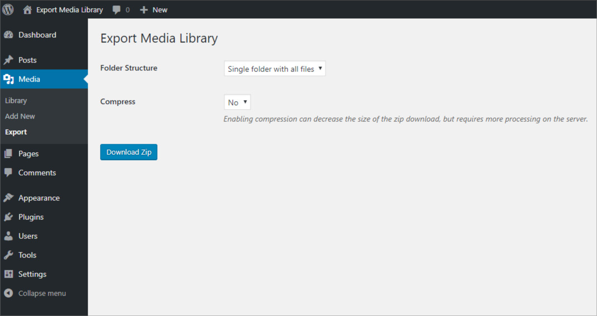
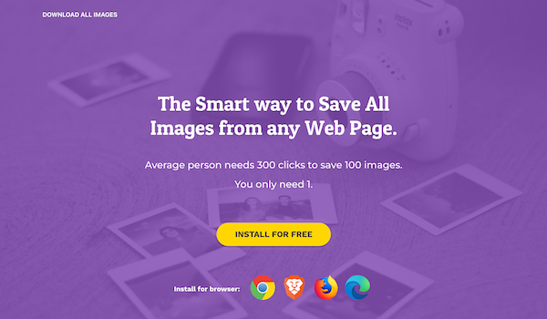

So you've got a ton of images uploaded to your WordPress Media Library, but what if you need to download them, how do you do that?

Well, as it turns out, there are several ways you can download images from WordPress Media Library, depending upon your needs.

<video src="/assets/blog/6-ways-download-images-from-wordpress-media-library/right-click-save-as.mp4" poster="/assets/blog/6-ways-download-images-from-wordpress-media-library/right-click-save-as.jpg" width="800" height="436" autoplay loop muted playsinline preload="none" aria-label="Right-clicking an image on a web page and choosing Save Image As"></video>

## Right-Click & "Save As"

Okay, so forgive the shameless self promotion in the above image, but I was already on my website, so it was a quick and easy option.

At any rate, if you're on the front-end of your site, right-click and choose "Save Image As" or whatever options are available in your browser.

From there you should be able to download the image to the desired location on your local device.

I typically download to desktop items I'll be working with right away, and then assign them a permanent location when I'm done.

<video src="/assets/blog/6-ways-download-images-from-wordpress-media-library/click-grid-mode-download-image-file.mp4" poster="/assets/blog/6-ways-download-images-from-wordpress-media-library/click-grid-mode-download-image-file.jpg" width="800" height="452" autoplay loop muted playsinline preload="none" aria-label="Opening an image in the WordPress Media Library grid view and clicking Download file"></video>

## Use the Download Link

If you're in the back-end, you can download image files by clicking into Grid view.

From there, locate and hover over the image file you'd like to download and click the "Download File" link. Easy, huh?



## Media Export Plugin

To download multiple images at once, you can use plugins such as the excellent "[Export Media Library](https://wordpress.org/plugins/export-media-library/)" plugin.

This is useful for saving time when you have a large number of images to download.

Once you've installed the plugin, navigate to your Media Library and click the "Export" link.

From there you'll be presented with options to download select folders from your Media Library.

A word of caution, however: if you don't have extensive experience installing plugins, ask your developer to take care of this.

The last thing you want is to take down your site due to a conflict with your theme or another plugin.

Especially on a Friday evening at 4:55pm when you're about to head out and meet your significant other for dinner. You don't want that.



## Use Third-Party Tools

There are online tools and browser extensions that can help you download images from websites, including WordPress sites.

One hugely helpful option is the [Download All Images extension](https://download-all-images.mobilefirst.me/), which allows you to download all images on a page to a .zip file.

Note that this extension is only available for users running Chrome, Brave, Firefox or Edge as their browser.

As an alternative, tools like the [Image Extractor](https://extract.pics/) allow you to paste in the image URL to download it.

This can be particularly helpful if your site displays image files in .webp format, but you need to download the .png or .jpeg files.

<video src="/assets/blog/6-ways-download-images-from-wordpress-media-library/using-ftp-to-download-image-files.mp4" poster="/assets/blog/6-ways-download-images-from-wordpress-media-library/using-ftp-to-download-image-files.jpg" width="800" height="480" autoplay loop muted playsinline preload="none" aria-label="Downloading image files from the wp-content/uploads folder with an FTP client"></video>

## Download via FTP

If you have FTP access to your website's server, and are feeling adventurous, you can download files from your server.

The first thing you'll want to do is create an FTP user account and add your login info to an [FTP client like FileZilla](https://filezilla-project.org/).

Once you've connected via FTP, click the "wp-content" folder and then the "uploads" folder.

From there you'll see a listing of folders that contain images uploaded to your site.

In order to find your file, you'll need to know the date it was uploaded in order to locate the desired file.

This method works best, however, when you want to download a directory of files such as the "uploads" folder.


## Write Some Custom Code

If you know how to code, you can use PHP to get and save pictures from your Media Library. This approach provides more control and customization options.

```
$image_url = wp_get_attachment_url($attachment_id); // Get the image URL
$image_data = file_get_contents($image_url); // Fetch the image data
file_put_contents('/path/to/save/image.jpg', $image_data); // Save the image to your server
```

## Conclusion

As you can see there are several ways to get the job done, depending on your needs and abilities.

And having the right tools for the right job at ready when you need them most is a huge time saver.

As with any form of media, it's critical that you always respect copyright and licensing when downloading and using images.

Make sure you have permission to use them, especially if they are not your own.

The last thing you want is to get hit with a letter from the owner threatening legal action. That doesn't make for a great day.
