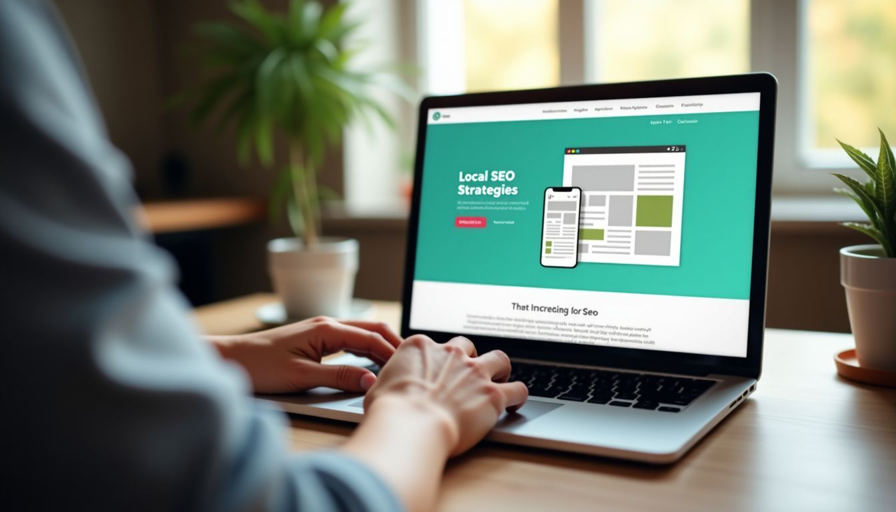

Spreading the word about your small business can feel like trying to be heard in a noisy room.

It's challenging, especially when you're competing with big companies. Yet, you know your local service or product deserves attention.

My adventure into WordPress back in 2010 opened my eyes to the struggle of making an impact online.

Striving to get noticed online and turn that interest into sales was my battle too.

Having been in the trenches of the digital marketing world since 2010, I know a thing or two about how to effectively market a local small business online.

This article shares those practical tips for enhancing your **small business marketing**.

From polishing your website to getting the most out of Google My Business and more. So: let's take a look at what you can do to get started.

### Key Takeaways

- Make a good website and use **Google My Business** to help people find you online.
- Share interesting posts and ads on **social media** like Facebook and Instagram. It attracts more customers.
- Ask happy customers to write reviews online. This makes others trust your business more.
- Work together with other local businesses for events or promotions. It brings in more customers for everyone.
- Sponsor local events or charities to show you care about the community. This builds good relationships with **potential customers**.

## Build a Strong Online Presence

To make your business known online, you need a professional and user-friendly website. Using [local SEO strategies](https://blog.hubspot.com/marketing/local-seo) will also help in ranking higher on search engines. These strategies can enhance your brand's visibility and draw more potential customers to your digital doorstep.

**Create a professional and user-friendly website**

I've been interacting with WordPress since 2010. My ultimate aim? To construct appealing and efficient websites for local businesses. My attention is primarily on sites that aid in **amplified visibility** on search engines like Google.

This implies the simplification of finding your business online.

> A website should function as your most effective salesperson, operating non-stop to attract customers.

Leveraging my acquired knowledge, I fabricate websites keeping your needs as a priority. These are user-friendly and contribute to making your business distinctive. A well-constructed website simplifies the process for individuals to understand your operations and connect with you.

Moreover, it's fundamentally about securing visibility prior to **potential customers** who are searching online for your offerings.

**Optimize your [Google My Business profile](https://www.google.com/intl/en_us/business/)**

After setting up a website, I turn my focus to [optimizing my Google My Business profile](/blog/master-google-business-profile-management-local-success/). This step is key for getting found online. A good profile makes it easy for customers to find me.

It shows my **location, hours, and services**.

I make sure all the information is correct and add photos of my work. I also ask happy customers to leave reviews. This boosts my spot in search results. Plus, it helps new customers trust me before they even meet me.

By doing this, I attract more local shoppers looking for what I offer. It's a simple yet powerful way to grow my business without spending a lot on ads.

**Use [local SEO strategies to rank higher](/blog/how-increase-visibility-local-search-results/)**

I always tell my clients, "**Local SEO** is your friend." To rank higher, first I make sure **Google My Business listings** are shipshape. It's not just about putting your name out there. You must fill in every detail.

Think of it as your business' digital handshake with local customers. **Keywords** matter a lot here. I do my homework to find exactly what people search for when they need services like ours.

Next up, **reviews** are gold dust. I encourage happy customers to spread the word online. More good words mean we climb higher in search results. This way, when someone looks for what we offer locally, our name pops up front and center.

Now let’s talk social media platforms and how they plug into this strategy.

## Leverage Social Media Platforms

Leveraging social media for your business can be a game-changer. Engaging content, targeted ads, and responsive customer interactions can boost your brand presence and attract new customers too!

**Create engaging and consistent content**

Creating **engaging and consistent content** is a key to success for small businesses. By consistently sharing **valuable and relevant content**, it helps build trust with the audience. Engaging content can drive **higher interaction and customer loyalty**.

"Creating great content is like building a bridge to your customers.

**Use [targeted local ads on Facebook and Instagram](https://www.facebook.com/business/ads/ad-targeting)**

Using **targeted local ads** on Facebook and Instagram is crucial for improving the visibility of your business within the community. These platforms allow you to reach specific local audiences, increasing the chances of attracting potential customers nearby.

By strategically placing ads, you can drive more traffic to your establishment and boost sales. Moreover, these platforms provide **actionable insights** that help refine your marketing efforts based on real-time data.

Small business owners should consider leveraging Facebook and Instagram ads as a way to efficiently manage digital marketing while focusing on core activities.

Additionally, integrating these local ad strategies into your overall marketing plan can significantly enhance brand awareness among the target audience, ultimately leading to greater customer engagement and loyalty.

**Respond to customer inquiries and comments**

When customers reach out with questions or comments, I recognize the significance of acknowledging them promptly. Engaging with their feedback helps **establish trust and loyalty**. It also offers valuable insights into their needs and preferences, enabling us to customize our products and services accordingly.

Responding to inquiries and comments not just demonstrates that we care about our customers but also provides an opportunity to display our expertise and strengthen brand reputation.

By including a **customer-centered approach** in my responses, I strive to ensure that every interaction leaves a favorable impression on the customer's mind.

## Develop Email Marketing Campaigns

To develop successful email marketing campaigns, build a local email list and send out newsletters with special promotions and updates. Automate follow-up emails for potential leads to keep them engaged and interested in your business.

If you want to learn more about creating effective email marketing strategies, read the full blog on our website!

### Build a local email list

Creating a **local email list** is essential for maintaining connections with your community. By gathering emails from your customers, you can send them updates, promotions, and valuable content directly to their inboxes.

This helps to strengthen your relationship with them and keeps your business top of mind.

To begin, consider including an email signup form on your website where visitors can easily subscribe. Offer incentives like exclusive discounts or freebies in exchange for their email addresses to encourage sign-ups.

Furthermore, when customers make a purchase or inquire about your products/services in-store or online, ask if they'd like to join your mailing list.

It's crucial to **segment your email lists based on demographics, buying behavior, or interests** so that you can personalize the content you send out. This will increase engagement and provide value tailored specifically to each subscriber's needs.

Remember to comply with relevant data protection laws and ensure that subscribers have opted-in before sending any marketing materials.

### Send newsletters with promotions and updates

I send out newsletters with special offers and the latest updates. I ensure the content is engaging and captivating. I aim to keep customers informed about our promotions and what's happening in our business.

When it comes to sending out emails, I always use a friendly tone and include **clear calls to action**.

Moreover, crafting these newsletters ensures that customers feel connected to our brand. It's also an opportunity for me to showcase positive reviews from other customers or highlight any recent achievements.

This helps build trust with our audience, making them more likely to engage with us in the future.

Now, let’s proceed to developing email marketing campaigns as another essential aspect of promoting your local business!

### Automate follow-up emails for leads

When leads express interest, automating follow-up emails is crucial. It ensures potential customers stay engaged and informed about your products or services. By setting up **automated email sequences**, you can nurture these leads without manual effort, increasing the chances of converting them into paying customers.

### Utilize marketing tools to streamline this process and enhance lead conversion.

Implementing automated follow-ups simplifies maintaining communication with leads. It also allows you to track customer interactions and adjust your strategy accordingly. This streamlining saves time and boosts efficiency within your sales funnel.

## Utilize Content Marketing

Content marketing involves creating valuable and relevant content to attract and engage a targeted audience. It's about crafting blog posts, videos, or other media that resonate with your local community and showcase what makes your business unique.

This approach can help you build trust, establish expertise in your field, and drive more people to choose your products or services. The goal is not just to sell but also to connect with potential customers on a personal level, making them feel understood and valued by your brand.

### Write blog posts relevant to your community

When you write blog posts pertinent to your community, it enhances your **local visibility** and builds connections with your audience. In my experience, sharing content that resonates with the people in your area can significantly improve brand recognition and **customer engagement**.

By including local events, news, or trends into your blog posts, you not only provide value to your audience but also position yourself as an authority within the community. This strategy has helped me connect with small business owners like us and establish trust and loyalty among our local customer base.

### Create short-form video content for social media

I transition from writing blog posts to creating **short-form video content** for **social media** by focusing on [using WordPress for video](/blog/wordpress-help/) creation and sharing. Short-form videos are a powerful tool, complementing SEO and PPC efforts.

They can boost visibility, reach **local audiences** effectively, and drive engagement. For me, as a developer helping businesses succeed with WordPress from my home in Novato, this deeply resonates as I've seen firsthand how impactful short-form videos can be in enhancing online presence and brand awareness.

The web is constantly changing; thus, adapting to the use of these videos is crucial. Utilizing experts to handle video production while focusing on core business activities can be an efficient approach.

By integrating actionable marketing tips into short-form video strategies for local businesses, owners can optimize their **digital marketing efforts** effectively.

### Share customer success stories

I met a local business owner who used **social media** to share stories from their happy customers. These real-life experiences created trust and excitement within the community, drawing more people to their business.

By showcasing these successful customer interactions, they were able to form deeper connections with new and existing clients, which boosted their sales and **brand awareness**.

One example is when the local bakery shared a story about how one of their regular customers surprised her daughter on her birthday with a custom cake. The heartwarming post received many likes, comments, and shares, spreading positive word-of-mouth for the bakery.

This strategy helped them attract new customers while strengthening relationships with existing ones based on genuine human connections.

## Partner with Other Local Businesses

Partnering with other local businesses can be a game-changer. It's all about working together to reach more people and create exciting opportunities. Whether it's teaming up for events, cross-promoting services, or supporting community initiatives, the impact can be huge.

### Collaborate on events or promotions

I've discovered that **collaborating with other local businesses** can be a potent way to enhance our event promotion and visibility. Working together for events enables us to attract more customers and curate distinctive experiences for them.

Moreover, partnerships help **reduce promotional costs** while amplifying the impact of our marketing endeavors. It's truly remarkable how joining forces with local businesses enables us to reach new audiences and expand our brand presence in the community.

Moreover, in events or promotions like these, I've observed firsthand that collaborative efforts can result in **increased foot traffic and stronger customer engagement**. By teaming up with others in the area, we're able to devise customized promotional strategies aimed at effectively reaching various market segments.

## Cross-promote each other’s services

Partnering with local businesses can be a game-changer for both parties. By collaborating, we can expand our customer reach and tap into new networks. This could lead to **increased foot traffic**, [more online visibility](/blog/reclaim-lost-time-get-kick-ass-marketing-results/), and a boost in overall sales.

Imagine teaming up with another business and sharing each other's services - it's a win-win situation.

I remember when I joined forces with a nearby café. We decided to promote each other’s services through social media shoutouts and joint events. It really paid off - we saw an increase in **customer engagement and loyalty** while also supporting the local community.

It’s all about building a network of mutual support that benefits everyone involved.

## Engage with Your Community

Sponsor local events and sports teams. Get involved in community fairs or markets. Support local charities and initiatives.

### Sponsor local events and sports teams

Sponsoring local events and sports teams can **boost community interaction** for your business. It creates **positive brand recognition** and goodwill when you support the neighborhood's activities.

These sponsorships also help direct more traffic to your website, potentially leading to **increased sales and customer loyalty**.

### Participate in community fairs or markets

Participating in local fairs or markets is a great way to enhance your business. This provides an opportunity to directly connect with potential customers and increase **brand visibility**.

It's also an excellent way to build relationships within the community, which can lead to **customer loyalty** and repeat business. It's important not to overlook these opportunities for direct engagement with your local audience.

Keep in mind, participating in community events is not only about selling products; it's about building connections and strengthening your presence within the community.

By joining local fairs or markets, you have a chance to reach more people who are interested in what you offer. Ensure you make the most of this opportunity as part of your overall marketing strategy.

### Support local charities and initiatives

Supporting **local charities and initiatives** is vital for establishing a strong connection with the community. It fosters essential relationships, enhances brand reputation, and sets your business apart from competitors.

By collaborating with local charities, businesses can create **mutually beneficial marketing opportunities** while increasing their visibility. This participation in community events not only supports meaningful causes but also leads to **increased customer loyalty and trust**.

By engaging in local charity work, businesses demonstrate care for their community's well-being and build strong relationships with potential customers. This kind of involvement goes beyond traditional marketing efforts and showcases a **genuine commitment to making a positive impact** on the local community.

Incorporating charitable acts into your business strategy provides you with direct experience of how contributing positively impacts both the recipients and your own reputation within the community.

## Encourage and Manage Online Reviews

Encouraging and managing online reviews is crucial for building trust and credibility with potential customers. Positive reviews can boost your brand's reputation, so it's vital to ask satisfied customers to leave feedback online.

Responding promptly to all types of feedback also shows that you value customer opinions. To learn more about the impact of online reviews on small businesses, delve into this topic in our upcoming blog post.

### Ask happy customers to leave reviews

I consistently **request reviews** from my happy customers. Those affirmative words can truly improve the visibility and credibility of my business online. Studies indicate that potential customers often rely on others' opinions, so I consider these reviews extremely valuable in attracting new business.

Additionally, effectively handling these reviews can significantly improve my business's reputation. Soliciting feedback and persuasive testimonials from satisfied clients is recommended to enhance your local reach.

Upbeat customer stories not only demonstrate your dependability but also **impact potential consumers' decision-making process**.

### Respond promptly to all feedback

I can attest from personal experience that **responding promptly to feedback** can significantly impact your business. Timely responses demonstrate to customers that you appreciate their input and prioritize their experiences.

Rapidly [engaging with feedback](https://www.ctl.ox.ac.uk/students-feedback) aids in effectively **managing online reviews**, thereby **bolstering customer satisfaction and loyalty**. It's not just about handling negative reviews; swift responses also enhance your online reputation, drawing in more customers and boosting visibility for your business.

Proactively engaging with feedback can transform unfavorable experiences into positive outcomes. Showing that you heed your audience's voice builds confidence and nurtures a robust relationship with potential and existing customers...

all while steering clear of the intricacies of navigating online marketing landscapes.

### Highlight positive reviews on your website

Positive testimonials on your website can significantly elevate your business. They establish confidence and credibility with potential customers, compelling them to select your products or services.

Incorporating these affirmative customer feedback into your marketing strategy can vastly improve engagement levels.

These testimonials not only help in convincing new customers but also have a positive impact on **search engine optimization** (SEO). Search engines like Google consider [customer reviews a crucial factor](https://www.indeed.com/career-advice/career-development/why-are-customer-reviews-so-important) for ranking websites.

The more favorable feedback you receive, the greater the likelihood of appearing higher in search results. Therefore, prominently showcasing these glowing endorsements on your website can be a game-changer for attracting new customers and fortifying your online presence.

Keep in mind, it's not just about receiving positive reviews, but also effectively highlighting them on your site to fully capitalize on their benefits.

## Offer Attractive Deals and Promotions

Offer appealing discounts to new customers, run seasonal promotions, and establish loyalty programs for repeat buyers. Implement strategies to increase customer engagement and drive sales.

### Provide discounts for first-time customers

Providing discounts for first-time customers is a smart way to attract new clients. It's an effective promotional strategy that can increase customer engagement and loyalty. These attractive deals can help your business stand out in the local market, **driving more traffic and sales**.

As a growth-focused small business owner, offering **first-time customer discounts** is crucial for enhancing visibility and attracting potential long-term customers.

Key concepts: Promotional strategies, **increasing customer engagement**, driving more traffic and sales.

### Run seasonal promotions

Running **seasonal promotions** is crucial for attracting customers to local businesses. Offering special deals during holidays or **local events** can significantly boost customer engagement.

Using effective marketing strategies can enhance the impact of these promotions, ultimately leading to increased website traffic and sales. By tapping into **digital marketing techniques**, you can maximize the effectiveness of your seasonal offers and reach a wider audience.

When planning your seasonal promotions, consider leveraging **social media platforms**, email marketing campaigns, and content marketing to create relevant and compelling offers for your target audience.

Engaging with the community through sponsorships and local events during these times can also help in driving more foot traffic to your business as people seek out deals and experiences associated with the season.

### Offer loyalty programs for repeat customers

Offering **loyalty programs** is essential for encouraging repeat customers. They can significantly enhance the effectiveness of attractive deals and promotions, leading to increased **customer retention** and improved **brand loyalty**.

Utilizing actionable marketing tips related to loyalty programs can drive more business and improve online visibility. Effective loyalty rewards are designed to improve customer satisfaction, thereby enhancing overall success in a local business.

As someone who has helped numerous businesses achieve success, I have seen firsthand how implementing effective loyalty programs can lead to increased customer retention and satisfaction.

## Track and Refine Your Marketing Efforts

After implementing your marketing strategies, it's crucial to track their performance and refine them for better results. This involves using analytics tools to measure how well your campaigns are doing and making adjustments based on the data insights you get.

Tracking and refining your marketing efforts will help you understand what's working and what needs improvement, ensuring that you get the best return on investment for your business.

### Use analytics tools to measure campaign performance

I track my marketing efforts with **analytics tools**. It helps me see what's working and what's not. By adjusting my strategies according to the data, I can make them more effective for reaching potential customers.

I use local businesses as an example of how analytics can boost visibility and lead generation. If they can do it, so can I.

### Adjust strategies based on data insights

Using the data from analytics tools, I track how our marketing campaigns are performing. This helps me refine and improve our strategies to increase our **online visibility**. By analyzing the results, I can identify any challenges we face in online marketing and adjust our SEO and PPC tactics accordingly.

It's important to focus on maximizing **ROI** by adapting strategies as the data evolves. Continuous monitoring and analysis help us stay competitive in local markets.

I regularly keep an eye on our campaign performance using analytics tools. This allows me to make informed decisions based on real data rather than guesswork or assumptions. As a small business owner, it’s vital to continuously adapt my **digital marketing strategies** according to insights gained from this data analysis.

## Conclusion

In wrapping up, I shared simple marketing strategies for small businesses to excel online. Firstly, it's crucial to establish a **strong web presence** and utilize social media platforms to interact with your audience.

Furthermore, employing **email marketing campaigns** and **content marketing** can help foster connections with potential customers. Keep in mind to collaborate with other local businesses and actively engage in your community, as this can improve your brand visibility.

Lastly, consistently monitoring and enhancing your efforts is essential for sustained success in the digital world.
