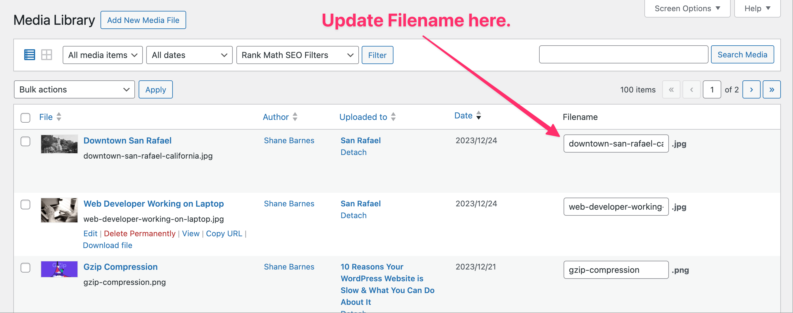

It goes without saying that adding images, video, and .pdf files to your blog posts provides visitors with an improved user experience.

Assuming the proper steps are taken, and images are well optimized, they can also provide a bit of a boost to your SEO.

However, without a strategy for managing media files prior to uploading them, your WordPress Media Library can become pretty cumbersome over time.

Among the common issues I see on new client sites are Media Libraries filled with files that make use of the default file-naming conventions in place when they were created.

## Finding Images by Filename

Because users typically associate image files visually, the naming of files themselves becomes an afterthought, that is until they need to be located in the Media Library.

When the Media Library is populated with thousands of images, scrolling through pages and pages of images in search of a single image can be a huge time suck.

This is where the search function in WordPress comes in handy when images are properly named prior to uploading them, but what about when they've already been uploaded?

That's when things get frustrating, particularly when the Media Library is populated with files named "IMG_0123.JPG", "DSC00789.jpg", "IMG_3122.HEIC", and other such filenames.

Imagine trying to find an image in a Media Library that's got thousands of images all named using the default image file naming conventions.

What *could* take place in seconds can end up taking several minutes to accomplish, robbing you of valuable time that could be spent on more important things.

Ideally image files should be renamed prior to uploading them, that way when you need to find them in the Media Library you can search for them by name.

But what's one to do when such files have already been uploaded to the Media Library? Just grin and bear it?

## File Renaming Options

By default, WordPress Media Library doesn't allow users to rename image file names; however, image files can be renamed via another method.

By installing the [Phoenix Media Rename](https://wordpress.org/plugins/phoenix-media-rename/) plugin to your business' WordPress installation, you can easily rename image files.

As you can see, filenames for images that already have titles are super easy to rename. With the click of a button, all images that already have a specified title are renamed accordingly.

If, however, you haven't specified a title for each image, you'll need to name the file yourself, which is where a meaningful naming convention will come in handy.

## How to Establish a Naming Convention

So, how do you go about creating a meaningful naming convention that will come in handy when searching for image files while also providing SEO value?

Following are my recommended steps for establishing naming conventions when renaming files in your WordPress Media Library:

1. Use at least three keywords that describe the image, e.g., "brown-dog-sunshine.jpg" to describe a brown dog sitting in the sun or "blue-bottle-table.jpg" to describe a blue bottle on a table. Use keywords only, avoiding stop words like "a", "the", "and", "or", etc.
2. Use lowercase characters only, as uppercase characters are treated differently and may create duplicate files.
3. No spaces or underscore characters, as these are bad for SEO.
4. Use hyphens only to separate words.

So long as you follow the above steps when renaming image files in your Media Library, you should be easily able to locate images within seconds.
