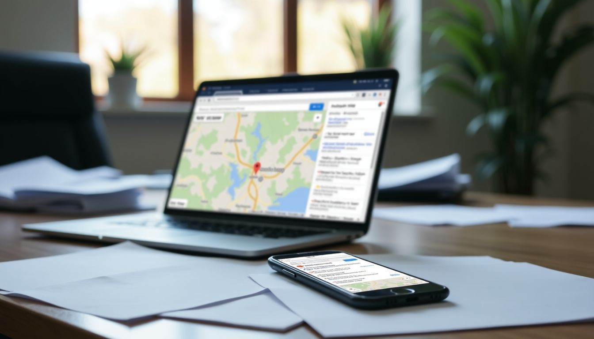

If you're new to marketing your local small business, **achieving visibility in local search results** can feel like an insurmountable task.

Having been at it since 2010, I know a thing or two about the challenges small business owners face generating more business online.

With tight budgets and limited resources most small business owners struggle to get noticed which is a shame, as 80% of local mobile queries conclude in sales.

So how can you give your local competitors a run for their money and achieve the best possible placement in Google's search results?

Well, that's what I explore in this post so without any further ado, let's dive in and discuss how you can do that very thing!

### Key Takeaways

- **Local SEO** helps small businesses appear in local search results. Use tools like **Google My Business** and pick the right local keywords.
- **Online reviews** are important. They affect how you show up in searches. Answer all reviews to build trust.
- Keep all your business info the same everywhere online. This helps people and search engines trust you.
- Use specific local SEO tools to see how you're doing and get better results.
- Stay engaged with your community online through social media and respond to feedback.

## Understanding Local SEO

Local SEO is largely comprised of optimizing your website and [Google Business Profile](https://www.google.com/intl/en_us/business/) so that you can achieve maximum visibility in search results.

Identifying the right local keywords, acquiring valuable links to your website, and managing online reviews are key components in this.

For a most small businesses, a well optimized Google Business Profile plays a key role in achieving top placement in search results.

This free tool lets you show your location on Google Maps and appear in local pack listings—where three local businesses pop up at the top of the search page.

I also spend time picking out local keywords that match what folks are typing into their search bars when looking for what I offer.

Next up, let's talk about why Local SEO matters so much for small businesses like ours.

<iframe src="https://www.youtube-nocookie.com/embed/pQSVsHvpTTA" title="YouTube video" loading="lazy" allow="accelerometer; encrypted-media; gyroscope; picture-in-picture" allowfullscreen></iframe>

## Importance of Local SEO for Small Businesses

**Local SEO** is a big deal for small businesses. It helps us show up where it matters most: right in your community. I've seen how 46% of Google searches are people looking for local info.

That means nearly half the time, someone types into Google, they want something nearby. If your business pops up, that's a win.

I also learned that when people search on their phones for something local, 80% of those searches end with them buying something or booking a service.

This is huge! For my business in Novato, getting on the first page of local search results means more customers coming through my door.

With tools like Google My Business and some smart keyword research, I make sure we're easy to find online. And since 28% of those local web hunts lead to a purchase, not showing up can mean missing out on a lot of sales.

In short, Local SEO isn't just important; it's essential for small businesses aiming to thrive in their communities.

<iframe src="https://www.youtube-nocookie.com/embed/FQ6Z_ywn2OI" title="YouTube video" loading="lazy" allow="accelerometer; encrypted-media; gyroscope; picture-in-picture" allowfullscreen></iframe>

## Optimizing Your Google Business Profile

I make sure my Google My Business listing has all the right details. I share my shop name, where it is, when we open, and our phone number.

I also put photos, what kind of things we sell or do, a short story about us, our website link, what customers say about us, common questions they ask us with answers, and extra things that make us special.

I always check to **keep everything the same across my websites and social media**. **Updates are key** too—I add new photos often and **talk back to folks who leave reviews**. This keeps my business fresh in people's eyes online.

<iframe src="https://www.youtube-nocookie.com/embed/vSDdAWwn8LU" title="YouTube video" loading="lazy" allow="accelerometer; encrypted-media; gyroscope; picture-in-picture" allowfullscreen></iframe>

## Conducting Local Keyword Research

When dominating local search, understanding the right keywords is crucial for small businesses like yours. Conducting [local keyword research](https://www.semrush.com/blog/local-keyword-research/) involves finding **industry-specific and location-specific keywords**, such as "salons in Los Angeles."

Using **Google's Keyword Planner and Google Trends** can provide valuable insights into **high-volume keywords for on-page optimization**.

Mastering this process enhances your local search results, bringing more potential customers to your doorstep.

In my experience, I've seen how incorporating these targeted keywords can make a significant impact on website traffic and customer inquiries.

By harnessing the power of localized search terms tailored towards your business niche, you'll be able to attract more engaged leads within your community.

It's not just about including keywords but strategically choosing the ones that will drive real growth for your business.

## Managing and Responding to Online Reviews

When it comes to managing and responding to **online reviews**, it's crucial for small businesses like us. Online reviews have a significant impact on **local search visibility**, with 53% of Americans reading them before making purchasing decisions.

Having faced many challenges in my journey as a business owner, I understand how important it is to engage with your audience when they post reviews of your services.

According to research, reviews make up 15% of **Google’s 3-Pack ranking factors**, emphasizing the imperative of addressing them proactively.

To that end, I strongly suggest launching review camapigns via Google My Business, email requests, social media platforms, and testimonials pages.

It's not only about encouraging positive feedback, but engaging attentively with both positive and constructive comments.

By integrating these strategies firsthand in my business endeavors, I can attest that **active management and personalized responses** help build trust among potential customers and improve local search rankings.

## Building Local Citations and Listings

Constructing **local citations and listings** is crucial for small businesses. It aids in enhancing visibility on search engines, making it simpler for potential customers to locate you.

When constructing these citations and listings, maintaining uniformity is crucial. Make certain that your business name, address, and phone number (NAP) are consistent across all platforms.

Assert and enhance your Google My Business profile to furnish precise details about your business.

This will also aid in appearing in local searches and on Google Maps. Moreover, contemplate listing your business on online directories such as Yelp or Yellow Pages.

These platforms can further enrich your online presence and augment the probability of being discovered by local customers searching for products or services like yours.

Keep in mind that [constructing local citations](https://www.semrush.com/local/blog/how-to-build-local-citations/) and listings is not merely a one-time task—it's an ongoing process that requires regular monitoring and updating to ensure accuracy across different platforms.

By doing so, you can establish confidence with search engines while effectively reaching potential customers in your area.

## Enhancing On-Page SEO for Local Search

When optimizing your website for local search, it's crucial to focus on certain factors that can make a big impact.

**On-page SEO** plays a vital role in ensuring your business shows up prominently when people in your area search for the products or services you offer.

By strategically incorporating **localized keywords** into your title tags, meta descriptions, and content, you can significantly enhance your website's visibility to potential customers nearby.

Moreover, besides using high-volume keywords appropriately across your website’s content for better optimization, pay attention to other elements like **header tags and image alt tags**.

These seemingly small details can actually make a substantial difference in how well your site performs in local search results.

Taking the extra time to optimize these on-page SEO elements specifically for local searches may require some effort but understanding their importance and leveraging them effectively will undoubtedly bolster the prospects of reaching more potential customers within proximity.

It becomes even more impactful when considering that 46% of all Google searches are looking for local information – pointing toward how critical it is to fully utilize every aspect of this essential feature.

Moving forward - **Local SEO Tools** will further assist us as they play an important role in fine-tuning our strategies...

## Using Local SEO Tools for Better Results

Now that we've laid a solid foundation for our **local SEO strategies**, it's time to bring in some helpful tools. Keeping track of how our business is performing and making necessary adjustments is key.

I suggest using Semrush for keyword research and Thryv for managing online listings. Also, Google Ads can be beneficial for paid campaigns if the budget allows. It's important to monitor progress by utilizing tools like Google My Business Insights to see what’s working and where improvements can be made.

## Supplementary Insights on Local SEO

As a small business owner, tracking your rankings in Google Maps and Search is crucial for understanding how customers find you. It's essential to engage with your local community online, which can significantly boost your visibility.

Moreover, ensuring the consistency of NAP (Name, Address, Phone Number) across all platforms is key to improving your local search presence. If you want to dominate local search and grow your business, read more about these insights!

### Tracking Your Rankings in Google Maps and Search

Tracking your business’s rankings in Google Maps and search is crucial for understanding how visible you are to potential customers.

Leveraging tools like Google My Business Insights provides valuable data on how many people view your profile, where they're located, and what actions they take.

As a growth-focused small business owner, this insight helps refine strategies and better understand customer behavior.

**Competitor analysis** is another essential element to monitor progress effectively. Staying aware of competitor activity enables adjustments to strengthen your position in local searches, ultimately helping dominate the competition.

So let's track those rankings and stay ahead!

### Engaging with Your Local Community Online

In growing a small business, **engaging with the local community online** is crucial. Use social media, videos, blogs, podcasts, webinars, and forums to create content. Respond to reviews - good or bad.

This builds confidence and shows you value customer feedback.

Additionally, as an expert in this realm of digital marketing, I know that **creating engaging content** will benefit your brand's online presence. Aim for it to be both informative and captivating.

This approach helps small businesses connect with their local community on a deeper level.

By embracing this strategy, growth-focused small business owners can develop meaningful connections locally while expanding their reach beyond geographical boundaries through effective use of digital platforms.

### Ensuring Consistency of NAP (Name, Address, Phone Number)

Ensuring **consistency across all platforms** is crucial. By **maintaining the same NAP** (Name, Address, Phone Number) throughout your online listings, you build trust with search engines and potential customers.

This **uniformity signals reliability** and strengthens your local SEO efforts. Inaccurate or conflicting information can negatively impact your visibility in search results and affect customer perception of your business.

## Conclusion

So, as we wrap up this guide on dominating local search, I hope you found these insights helpful.

Optimizing for **Local SEO** can be a game changer for **small businesses**, driving more foot traffic and online sales.

Understanding the importance of local SEO and taking actionable steps to optimize your business profile and **online presence** will significantly boost your visibility in local search results.

Keep in mind, engaging with the **local community**, managing reviews effectively, and maintaining consistency in your business information are equally crucial parts of this strategy. So don't underestimate their impact.

In a nutshell, mastering local SEO is pivotal for standing out in today's digital landscape. By implementing these strategies and staying proactive with your approach, you'll unlock new opportunities to reach and engage with potential customers around you.
