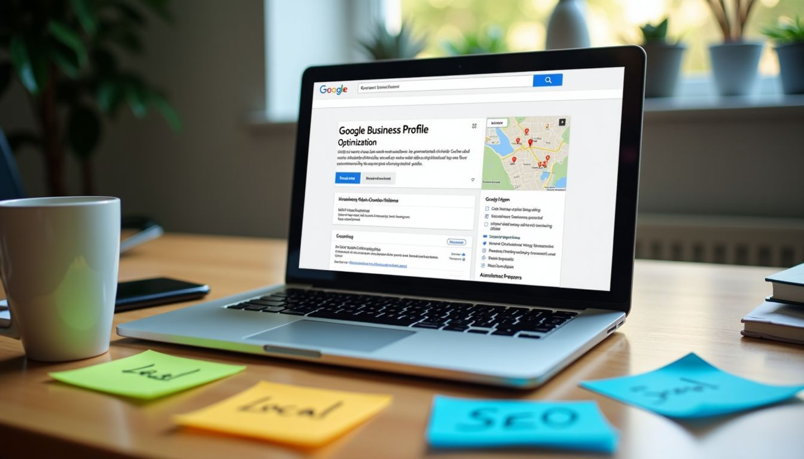

Struggling to get noticed online? Trust me, it's a common hurdle. You're aiming for your business to pop up in searches, and I've walked that path.

When I started out back in 2010, figuring out how to **highlight my business** on the web felt like a mystery.

And for many small business owners, that remains the case. With so much to do, and so little time to get it done, achieving and maintaining visibility online is one of the first casualties.

However, with a little time and effort, you can start to make a dent in your rankings and get results.

One of the first places to start, is [Google Business Profile](https://www.google.com/business/) Management—in fact, it's a **game-changer**.

And that's what we'll be taking a look at today, from getting started and optimizing your Google Business Profile, to managing your reputation and reviews.

So stick around—a few simple changes might be all you need!

### Key Takeaways

- Claim and create your **Google Business Profile** to show up more in **search results**.
- Keep your business info up-to-date for better **local SEO** and **customer trust**.
- Use the right **keywords** in your profile to be found easily online.
- Get and **manage reviews** to improve your **reputation** and attract more customers.
- Answer **customer feedback** to **build trust** and keep people interested.

## Claiming and Creating Your Google Business Profile

When it comes to enhancing your online visibility, claiming and creating your Google Business Profile is crucial.

By optimizing your Google Business Profile with [accurate business information](https://www.safegraph.com/guides/why-accurate-data-is-important), keywords for [improved SEO benefits](https://www.forbes.com/councils/forbesagencycouncil/2021/06/14/10-key-benefits-of-seo-for-your-business/), and effective customer engagement strategies, you pave the way for maximizing your [local search presence](https://moz.com/learn/seo/what-is-local-search-marketing-seo) and attracting more potential customers.

### Claiming unclaimed profiles

I help businesses make a big move online. First, I search for Google My Business profiles that haven't been claimed yet. Claiming these profiles is key for showing up more in search results.

To claim them, I verify the business's realness and ownership. It's like telling Google, "Yes, this place is mine." Once done, you get to control and share accurate information about your business.

This also **boosts local SEO**. Imagine it as tidying up and hanging a sign on your digital storefront, telling everyone you're open and easy to find online. With my experience since 2010, I've successfully managed this process multiple times.

Rely on me to enhance your visibility in Marin County smoothly.

### Setting up new profiles from scratch

After claiming profiles, it's time to create new ones. Setting up a new Google Business Profile might seem tough, but it's not hard with help. First, **pick the right categories**. This helps people find your business in searches.

Next, I'll write a **clear description** and place the map pin accurately. These steps are crucial today, sometimes as much as having a website! They ensure that when someone searches for what you offer, your business comes up first.

Let me take care of this for you.

## Optimizing Your Google Business Profile

Want to maximize your Google Business Profile? Ensure accurate business information and use relevant keywords for better visibility in search results. Engage with customers by encouraging feedback and responding effectively to enhance customer relationships.

### Updating business information accurately

Life is busy, especially for small business owners focused on growth. It's vital to keep your Google Business Profile updated. A whopping 93% of people read **online reviews** before making a decision.

Moreover, nearly half of all searches aim to find **local information**. If your business details are incorrect, think about the missed opportunities and confusion it can cause!

I always make sure to update my company info correctly, including changes in addresses, hours, and services.

Taking this step also increases visibility in **local search results**. With accurate information, more customers can find me instead of going to a competitor’s location or website.

I have noticed that staying updated leads to better review ratings and more traffic to my site.

Updating these details is straightforward but plays a significant role in being discovered online by potential clients in Marin County or wherever they might be searching from.

### Utilizing keywords for SEO benefits

Using the right words is important. Adding **relevant keywords** to your Google Business Profile will make it show up more on **search engines**.

This means that when people look for services like yours, they'll have a better chance of finding your profile.

For example, putting "local search engine optimization" in your profile can make it easier for people in your area to discover your business. By using these methods, you can get ahead and attract more customers.

I've seen businesses boost their **online visibility** and customer interest by doing this. It's a crucial step in making the most out of your Google Business Profile.

## Acquiring and Managing Ratings and Reviews

Become a standout in your industry with an exceptional online reputation. Effectively encourage valuable customer feedback and craft meaningful responses to elevate engagement. Your business will thrive with an impeccable rating and review management strategy.

### Encouraging customer feedback

I understand the significance of **customer feedback**. Your opinion helps us grow and address your needs better.

I value your thoughts on how we can improve our service to you. Share your experience with PartnerPress, LLC so that we can continue customizing our services to meet your needs.

Keep in mind, customer testimonials and **online feedback** are vital for improving our reputation and building brand loyalty.

Your satisfaction is my top priority, and your input will help others discover what makes PartnerPress, LLC exceptional in the field of local search marketing services.

Let's continue this dialogue by sharing your thoughts through ratings and reviews!

### Responding effectively to enhance engagement

Responding to **customer ratings and reviews** is important for gaining trust and boosting engagement. Engaging with feedback helps us improve satisfaction and enhance our online reputation.

Customer testimonials and FAQ responses are effective ways to increase engagement, while also improving the overall customer experience.

We aim to use these strategies to build long-term relationships with our customers and achieve **sustained business growth**.

## Conclusion

Managing your Google Business Profile is crucial for **boosting online visibility** and attracting more customers. From claiming and optimizing your profile to **acquiring positive reviews**, every step contributes to your business success.

Let's focus on making the most of these strategies to drive growth!

## FAQs

### 1. What is Google Business Profile Management?

Google Business Profile Management helps businesses manage their online presence on Google. It allows them to update important details, like hours of operation and contact information, making it easier for customers to find them.

### 2. Why is managing my Google Business Profile important?

Managing your profile boosts your visibility in search results. A well-maintained profile attracts more customers by providing accurate information about your business and services.

### 3. How can I improve my Google Business Profile?

To improve your profile, add clear photos, respond to customer reviews, and keep all details up-to-date. Regular updates help engage potential customers and show that you care about their experience.

### 4. What should I do if I receive a negative review on my profile?

Responding to negative reviews calmly is key. Acknowledge the customer's concerns and offer solutions if possible. This shows future customers that you value feedback and are willing to make things right.
