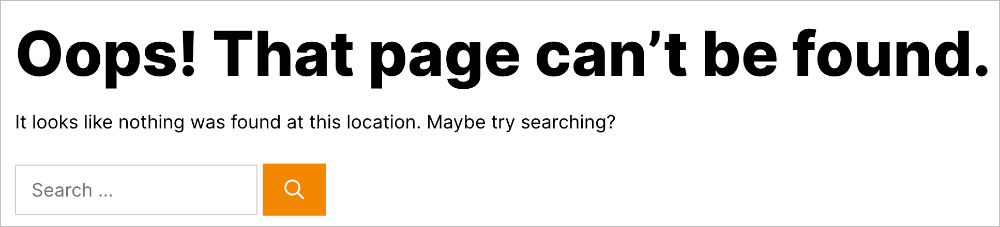
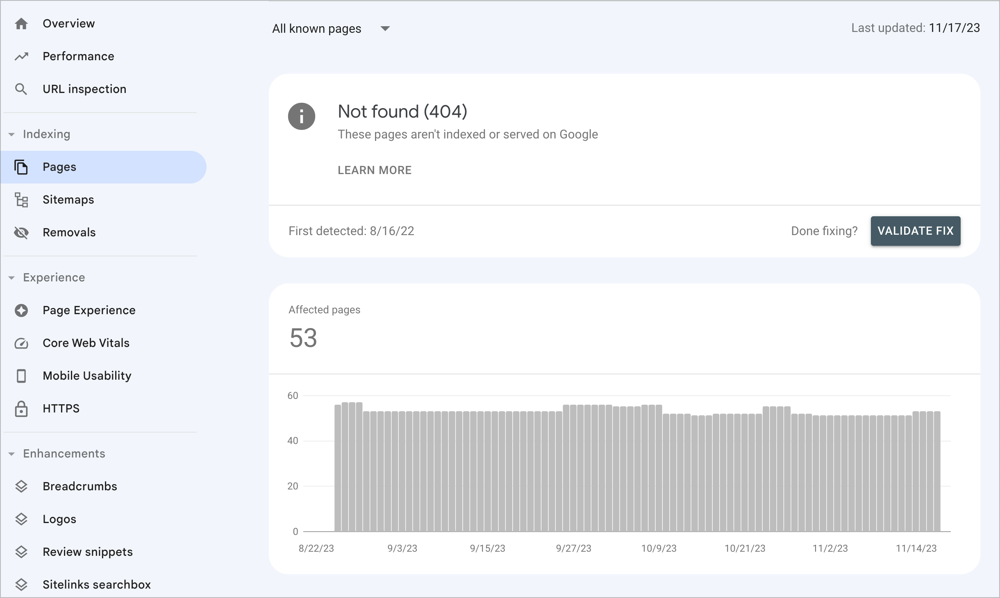
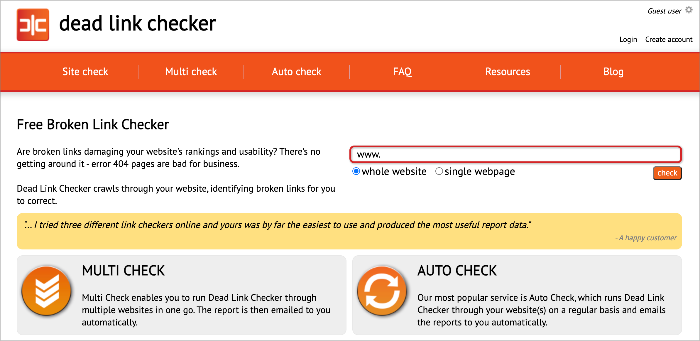
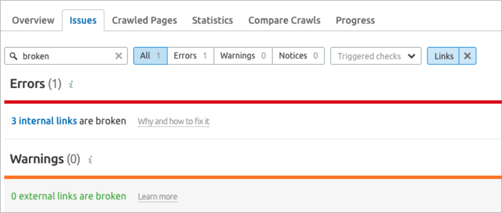

## What are Broken Links?

**Broken links**, also referred to as **dead links**, are hyperlinks found on a website that are no longer functional.

Broken links are a common problem that arises when a link directs users to a web page that has either been relocated or deleted, leading to the display of an error message, usually a [**404 Not Found Error**](https://en.wikipedia.org/wiki/HTTP_404).

These non-working links can be quite frustrating for users and have a negative impact on the overall performance and functionality of a website, as well as rankings in search results.

## Types of Broken Links

### Internal Broken Links

These links point to pages, posts, images or other files such as pdf's on your website that are no longer available.

Causes include renaming or deleting pages without updating internal links, or deleting images from the WordPress Media Library.

This is a common problem when a website has multiple users editing and/or deleting content such as pages, images and pdf files.

### External Broken Links

These occur when linked pages on external websites are removed or relocated.

Since website owners have no control over external sites, these links can break without their knowledge.

## Impact of Broken Links

### User Experience

Broken links can have a negative impact on the overall user experience.

When users come across broken links, it can lead to frustration and disappointment.

Ultimately, you risk sending visitors elsewhere, which in turn increases [bounce rates](https://backlinko.com/hub/seo/bounce-rate) and decreases user engagement.

A poor user experience caused by broken links can be detrimental to a website's success.

Users expect to find relevant and reliable information when they click on a link.

However, when they encounter a broken link, it disrupts their browsing experience and can make them question the credibility of the website.

High bounce rates, which occur when users leave a website shortly after arriving, can signal to search engines that the website is not providing valuable content.

This can negatively impact the website's search engine rankings and visibility.

To ensure a positive user experience, it's essential to regularly check for broken links and promptly fix them.

This can be done through regular website maintenance and utilizing tools that identify broken links.

By addressing broken links proactively, website owners can enhance user satisfaction, improve bounce rates, and increase user engagement.

### Search Engine Optimization (SEO)

Search engines, such as Google, take into account the integrity of links when determining the ranking of websites.

It's important to note that broken links can have a detrimental effect on a website's SEO performance, resulting in lower search rankings.

Therefore, it's crucial for website owners to ensure that all links on their site are functioning properly and lead to relevant content.

By maintaining link integrity, website owners can improve their chances of achieving higher search rankings and attracting more organic traffic.

## How to Fix Broken Links

### Step 1: Check for Broken Links

To identify broken links on your site, you can utilize free tools such as the [Dead Link Checker](https://www.deadlinkchecker.com/), or you can take it a step further with more powerful tools like [Screaming Frog](https://www.screamingfrog.co.uk/broken-link-checker/).

These tools are designed to help you pinpoint any broken links that may exist within your website.

By using these tools, you can efficiently detect and address any broken links, ensuring a seamless user experience for your visitors.

### Step 2: Configure Redirects

To ensure a smooth user experience and maintain the SEO value of your website, it's important to implement 301 redirects for internal links that point to moved or renamed pages.

A 301 redirect is a permanent redirect that informs both users and search engines that a page has been permanently moved to a new URL.

By doing so, you can seamlessly redirect visitors and search engines to the new location of the content they are looking for.

This helps preserve any existing rankings, backlinks, and traffic associated with the old URL.

### Step 3: Update or Remove Broken Links

To ensure the accuracy and relevance of your content, it's important to regularly update any external links included in your text.

This will help maintain a positive user experience and prevent visitors from encountering broken or outdated links.

If you come across an external link that no longer exists or leads to irrelevant content, it's advisable to remove it altogether.

By doing so, you can enhance the credibility and reliability of your information.

Remember, keeping your content up-to-date is crucial for providing valuable resources to your audience.

## Preventing Broken Links

### Step 1: Maintain Consistent URL Structures

When updating your website, it's important to maintain consistent URL structures in order to avoid breaking internal links.

If you change the URL structure of a page without properly redirecting the old URL to the new one, all the internal links pointing to that page will become broken.

This can lead to a poor user experience and negatively impact your website's SEO.

To prevent this from happening, it's recommended to implement proper redirects when making changes to your URL structure.

This ensures that any internal links pointing to the old URL will automatically redirect to the new URL, preserving the link juice and maintaining a seamless user experience.

By maintaining consistent URL structures and implementing proper redirects, you can ensure that your internal links remain intact and functional.

This not only improves the usability of your website but also helps search engines understand the structure and hierarchy of your content, ultimately boosting your SEO efforts.

So, be mindful of your URL changes and take the necessary steps to preserve your internal links.

### Step 2: Set Up an Automated Scan

In order to stay ahead of broken links and get them fixed promptly it's best to run an automated scan on at least a weekly basis.

This becomes even more crucial if you're regularly publishing content or making any changes or updates to your site.

The best way to do so is to use a site audit tool like those that can be found in tools like [SEMRush](https://www.semrush.com/siteaudit/) or [Ahrefs](https://ahrefs.com/website-checker).

## Conclusion

By implementing these practices, you can minimize the impa broken links can have on your business, and provide a seamless browsing experience for your users.

Additionally, search engines value websites that have a low number of broken links, which can positively impact the website's SEO standings.

In short, investing time and effort into maintaining a website free of broken links will prevent embarrassing errors and provide your visitors with a flawless experience.
