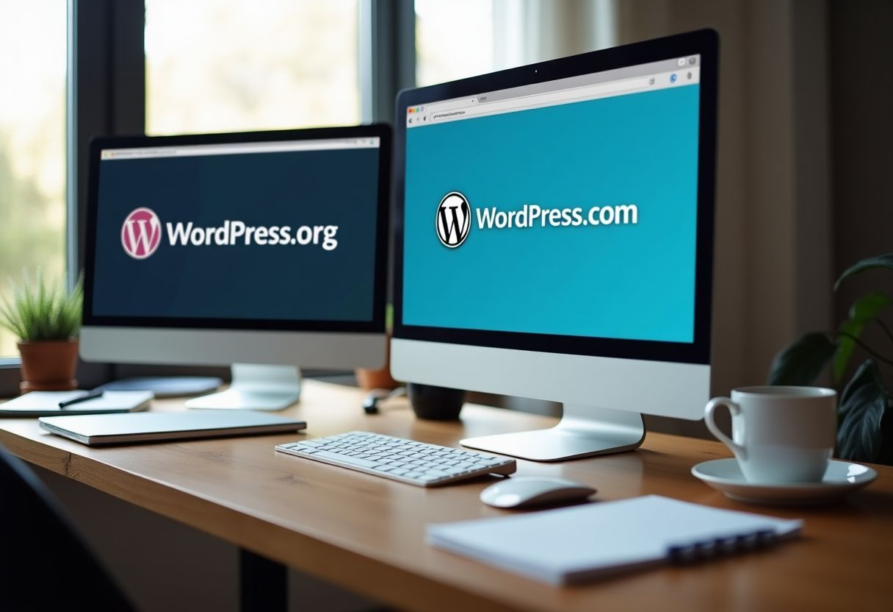
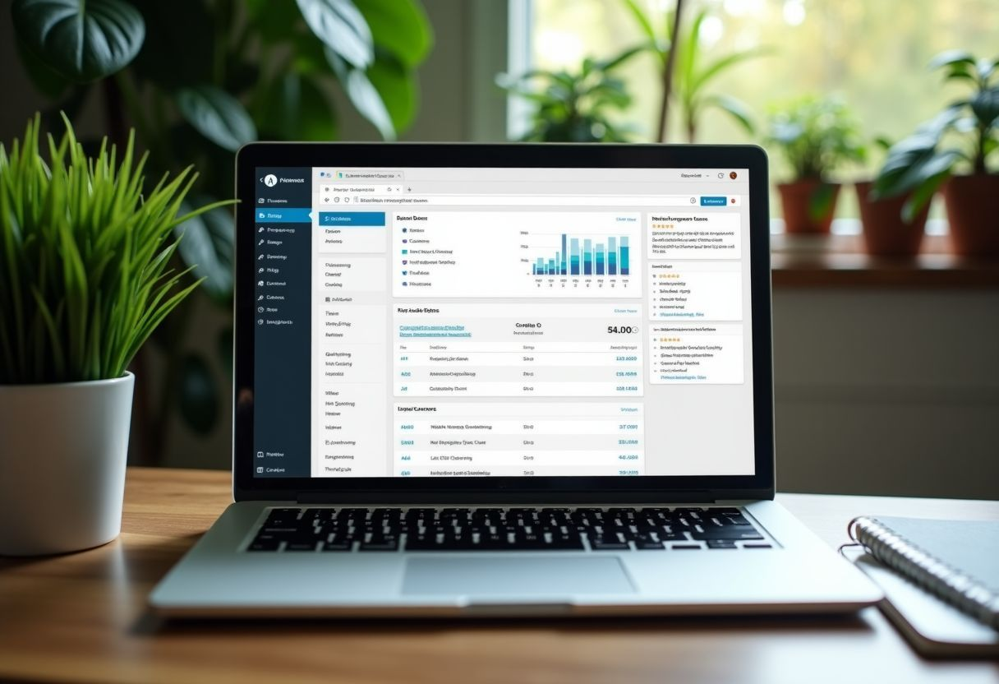
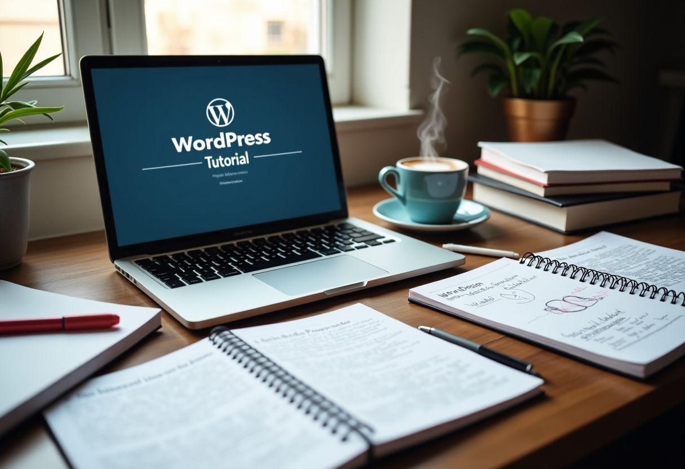

Building a website feels tough, right? You might worry about needing lots of tech skills or hiring an expert. I've been there too.

In fact, over 43% of all web pages use WordPress because it's so easy to customize to your exact needs.

Why choose WordPress? It pairs ease with powerful features like themes and plugins which let you shape your site without coding knowledge. This guide walks you through everything—from setting up to adding those special touches that make your website stand out.

Stay tuned—I promise it's easier than you think!

### Key Takeaways

- WordPress makes building websites easy and is used on over 43% of all web pages.
- It started in 2003, primarily as a blogging tool, but now supports all kinds of sites including business and e-commerce.
- Users can choose between WordPress.org for full control or WordPress.com for simpler setups.
- Themes and plugins help customize your site without needing to know coding.
- Major names like WHITEHOUSE.GOV and MICROSOFT use WordPress for their websites.

Starting a website can feel tough. You may want to grow your business online but worry about the technical stuff. When I discovered WordPress in 2010, I realized it offered something special for beginners.

Here's an important point: **WordPress powers over 40% of all websites globally**. It stands out as a top web creation tool due to its ease of use and wide acceptance. I spent years mastering its features—from setting up blogs to building e-commerce sites—and saw how well it adapts to any site's needs.

This guide will simplify "What Is WordPress," illustrating how it facilitates web creation for anyone, especially small businesses aiming to grow. Let's explore this together.

### Key Takeaways

- WordPress is a system that helps you build websites easily. It started in 2003 and now supports over 43% of all sites on the internet.
- You can use WordPress for free because it's **open source**. This allows anyone to see and modify how it works. There are many designs (themes) and tools (plugins) to make your site work the way you want.
- With WordPress, you can set up different types of websites like blogs, stores, forums, and more without much tech knowledge.
- There are two versions of WordPress: **WordPress.org and WordPress.com**. Each serves different needs. Use .org for **full control**, or choose .com if you prefer an **easy setup** without technical tasks.
- How your website looks is crucial. **Themes** shape how your content appears to visitors. You don’t have to know coding to style your site with themes.

## What is WordPress?

Moving forward, let's discuss WordPress. It's a content management system that makes website building straightforward and accessible. Created in 2003, this platform has expanded considerably.

Today, it powers over 43% of all web pages. Chances are many of the sites you browse are crafted using this versatile tool.

WordPress is freely available because it embraces an open-source model. This approach allows anyone to modify its code to meet their specific needs — perfect for creating blogs, online stores, forums, and more with ease.

The platform boasts a vast repository of stylish themes and functional plugins that enhance your site's capabilities.

<iframe src="https://www.youtube-nocookie.com/embed/71EZb94AS1k" title="YouTube video" loading="lazy" allow="accelerometer; encrypted-media; gyroscope; picture-in-picture" allowfullscreen></iframe>

## Key Features of WordPress

[WordPress is open-source](https://wordpress.org/about/), allowing flexibility and customization with plugins and themes—a crucial aspect for customizing your website to suit your specific needs. This platform's extensibility empowers users to effortlessly add features and functionalities as their site grows, making it a scalable solution for any kind of website.

<iframe src="https://www.youtube-nocookie.com/embed/kYY88h5J86A" title="YouTube video" loading="lazy" allow="accelerometer; encrypted-media; gyroscope; picture-in-picture" allowfullscreen></iframe>

### Open-source nature

WordPress is not just any tool for making websites. It's **open-source**. This means anyone can see how it's made and change it to fit their needs. People love this because it makes WordPress free to use.

You don't have to pay for the basic system at all.

The open-source part of WordPress follows the **GPLv2 license** from the Free Software Foundation. A big group, called Automattic, looks after a part called WordPress.org without making money from it.

> Open-source means freedom - freedom to build, share, and grow your ideas.

Lots of smart people work together on WordPress, adding new things and fixing problems. Everyone can help make it better by giving feedback or even changing parts themselves! Plus, using an open-source platform like this keeps your costs low while you build your website.

### Extensibility with plugins

Plugins make WordPress powerful. Think of them as apps for your website. With [over 50,000 free options](https://www.usa.gov/government-grants-and-loans), you can **add many features without coding**. Want a contact form? There's a plugin for that.

Need to improve your search engine rankings? Plugins like Yoast SEO can help.

Next up is making your site look great with themes.

### Variety of themes

WordPress offers a **wide range of themes** that cater to various industries and styles, providing a customized look for your website. With over 5,000 free themes available, you can easily find one that suits your business's unique identity.

These themes are not only **visually appealing**, but also **mobile-friendly,**, ensuring an optimal user experience across different devices. By choosing the right theme, you can create a professional and customer-engaging online presence without the need for complex web design skills.

Themes play a crucial role in how your content is presented to visitors. They influence the layout, color scheme, and overall visual appeal of your website. Whether you're aiming for a sleek corporate feel or a cozy personal blog vibe,, there’s likely a suitable theme available in WordPress’ extensive repository.

You can even customize these themes with widgets and menus to make it truly yours without needing intricate coding knowledge!The Evolution of WordPress

WordPress has come a long way from its origins as a simple blogging platform. It has evolved into a powerful and versatile content management system (CMS), driving millions of websites across the internet.

Want to delve deeper into WordPress' fascinating journey? Read on....

<iframe src="https://www.youtube-nocookie.com/embed/8AZ8GqW5iak" title="YouTube video" loading="lazy" allow="accelerometer; encrypted-media; gyroscope; picture-in-picture" allowfullscreen></iframe>

### Origins and development

In 2003, WordPress came to life as a part of the b2/cafelog project. Its founders are Matt Mullenweg and Mike Little. It has grown into one of the most popular open-source content management systems globally.

The evolution of WordPress includes significant milestones like its growing user base and continuous improvements in features and security.

WordPress started as a blogging platform but quickly expanded into a versatile website builder that could support various types of websites including e-commerce platforms and membership sites.

Over time, it has evolved to become more user-friendly with an extensive range of plugins and themes available for customization.

### Key milestones

In 2003, WordPress was born as a simple blogging platform.

- In 2005, the introduction of themes allowed for website customization.
- By 2011, WordPress reached 100 million plugin downloads, showcasing its extensibility and adaptability.
- The launch of Gutenberg editor in 2018 revolutionized content creation for users.
- As of 2022, WordPress powers over 60 million websites worldwide.

After these significant milestones, WordPress continued to evolve and grow.

<iframe src="https://www.youtube-nocookie.com/embed/8AZ8GqW5iak" title="YouTube video" loading="lazy" allow="accelerometer; encrypted-media; gyroscope; picture-in-picture" allowfullscreen></iframe>

## WordPress. org vs WordPress. com

[WordPress.org and WordPress.com](https://www.reddit.com/r/Wordpress/comments/rremcd/the_difference_between_wordpress_com_and_org/) serve different needs for website builders. To determine the best fit for your project, it's vital to explore their features and how they meet your specific needs.

If you're looking to understand how each platform can support your website objectives, continue reading.

### Comparison of features

Deciding between WordPress.org and WordPress.com is similar to choosing between buying and renting a house—each offers distinct advantages. As someone who has crafted websites on both platforms for years, I can provide insights on what suits various needs best. Here's a clear comparison:

| Feature | WordPress.org | WordPress.com |
| --- | --- | --- |
| **Cost** | Free, but you must pay for hosting and domain name | Free plan available, paid plans offer more features |
| **Customization** | Total theme and plugin support for custom needs | Limited by your chosen plan |
| Control | You fully own your content and site | Your site is owned by WordPress.com, with certain restrictions |
| Monetization | Total freedom in monetizing your site as you wish | Earning options vary based on plan limitations |
| Support | Broad community help; you manage maintenance yourself | Dedicated customer service; more direct assistance |
| Setup | Some technical skills needed at the start | User-friendly, quick setup |

For small business owners aiming for growth, picking the proper platform is crucial. If full control and technical handling are in your capability, WordPress.org allows you to create exactly what you envision. Conversely, if ease of setup with some restrictions sounds better, WordPress.com offers a swift way online. Both routes present substantial benefits depending on your capabilities and goals—I've watched businesses flourish using either option. Reflect on what you need from your website before making a final decision.

### Choosing the right platform for your needs

Consider whether complete control over customization or managing hosting appeals more to you when evaluating these options.

Both platforms have strong points—flexibility comes with WordPress.org while convenience follows WordPress.com. Assess elements like domain names, web hosting demands, and design abilities before selecting an avenue that matches well with your professional growth objectives.

## Building Different Types of Websites with WordPress

 Building various websites with WordPress is simple. You can make blogs, business sites, e-commerce platforms, and membership sites. Each type requires different plugins and themes to get the best results.

Want to learn more about creating your specific site?

### Blogs and personal sites

I chose to focus on these 2 categories as they are the most common uses of WordPress websites. Small business owners can benefit from having a blog to share their expertise, industry insights, and company updates with potential customers.

Personal sites provide an excellent platform for showcasing the individual behind the brand, establishing credibility, and promoting authenticity. Both of these website types can be incredibly effective in building brand relationships.

WordPress offers easy-to-use tools for creating blogs and personal sites. These include customizable themes that allow you to create unique designs without needing any coding knowledge.

The built-in media library also simplifies adding images and videos to your posts or pages. Moreover, its search engine optimization capabilities ensure your content reaches a wider audience.

By using WordPress's features designed for blogging and personal branding such as seamless post creation interfaces - complete with intuitive SEO tools - small businesses can efficiently establish their online presence while giving a glimpse into the personalities driving their operations.

### Business websites

Creating a website for my business? WordPress is the answer. It's user-friendly, packed with numerous features, and adaptable to various website types, such as e-commerce platforms and membership sites.

Notably, major players like WHITEHOUSE.GOV and MICROSOFT also use WordPress.

WordPress allows you to craft a website finely suited to your business needs with minimal complexity. Whether you need an online store or a platform for online courses, WordPress provides an easy setup and strong security measures.

I've seen firsthand how businesses have grown by using WordPress for their online presence—so why not consider it for yours as well?

### E-commerce platforms

E-commerce platforms are essential for online stores. WordPress supports creating e-commerce websites with plugins and themes. This means small businesses can set up their shops on WordPress, making it simpler to manage sales and customers.

Using WooCommerce, an official plugin for e-commerce, users can sell products through WordPress sites. This helps in managing inventory, processing payments securely, and presenting products attractively.

With this functionality at hand, business owners like me have the opportunity to reach more customers. It's clear that having an e-commerce platform within WordPress is beneficial for business growth as we're able use one comprehensive platform for all aspects of running a successful store.

Next, let’s explore building membership using WordPress...

### Membership sites

E-commerce platforms are a strong option for online selling, and membership is another valuable tool for expanding presence. WordPress supports creation, allowing you to restrict access to specific content or resources only for members.

This feature is especially beneficial for offering exclusive products, services, or information meant for a select group of individuals. Leveraging this functionality, small businesses can establish a community-driven approach and generate recurring revenue through subscriptions and member fees.

Considering my first-hand experience with numerous businesses utilizing WordPress and integrating membership into their digital strategies, this approach has enhanced customer loyalty and engagement over time. This tactic has proven effective in areas like fitness training programs, educational courses, and professional networking communities within industries, offering customized solutions for audience needs and unlocking potential for sustainable growth and long-term value.

<iframe src="https://www.youtube-nocookie.com/embed/jl8F4WglM3I" title="YouTube video" loading="lazy" allow="accelerometer; encrypted-media; gyroscope; picture-in-picture" allowfullscreen></iframe>

## Why Choose WordPress?

 ?

When selecting a website platform, choosing one that's easy for beginners and secure is crucial. WordPress excels in these areas — offering excellent SEO features and a wide support network. It fits various websites: from business sites and blogs to e-commerce and membership platforms.

### User-friendly for beginners

I found WordPress incredibly straightforward when I first used it. You can set up a website without any coding knowledge, making it perfect if you're not a tech expert. Plus, the user-friendly dashboard makes managing your site simple — from posting blogs to updating the design with just a few clicks.

### Strong SEO capabilities

WordPress comes packed with tools to boost your site's visibility on search engines. Optimizing content and crafting SEO-friendly URLs are made easy with the right plugins.

It offers effective ways to improve your search engine ranking. You can also integrate tools like Google Analytics to track your progress and refine your strategies based on solid data.

These features are vital for small businesses striving to stand out online where being seen opens new opportunities.

Next up: Building Different Types of Websites with WordPress...

### Robust security features

WordPress is known for its strong security measures which protect against threats. It includes security patches, plugin architecture, and two-factor authentication — ensuring your site's safety.

Regular updates and bug fixes enhance these defenses even further — helping shield your site from common vulnerabilities and risks.

### Extensive support community

Transitioning now to the extensive support community around WordPress — this vibrant group hosts local meetups and WordCamps worldwide where users share their insights.

Many small business owners gain valuable help at these events due to the accessible, flexible nature of this network — making tackling any challenge easier alongside peers ready to explore new ideas together!

<iframe src="https://www.youtube-nocookie.com/embed/71EZb94AS1k" title="YouTube video" loading="lazy" allow="accelerometer; encrypted-media; gyroscope; picture-in-picture" allowfullscreen></iframe>

## Getting Started with WordPress

Are you ready to begin your WordPress journey? First, set up your site and choose a theme that suits your style. Then, install vital plugins to enhance the functionality of your website without getting overwhelmed by the internet intricacies.

## Setting up a WordPress site

To set up a WordPress site, here's what you need to do:

1. Acquire a **WordPress hosting service and a domain name**. This is like securing your site's land and address on the internet.
2. Install WordPress through the hosting provider's **one-click installation tool or manually** by uploading files to the server.
3. Establish a database for WordPress to store all your content, settings, and user information.
4. Personalize your site by choosing a suitable theme that reflects your business's personality and branding.
5. Integrate **essential plugins** to add specific functionalities like contact forms, SEO optimization, and security measures.
6. Organize your website's pages, navigation menus, and any extra features to improve user experience.
7. Ensure your site is mobile-friendly as more people access the internet through their phones than ever before.

Having direct involvement with these steps will help you craft an appealing online presence for your business!

## Selecting a theme

When selecting a theme for your WordPress site, keep these factors in mind:

1. **Visual Attraction** - A theme should represent your brand's identity and convey a professional image to potential customers.
2. **Responsiveness** - Ensure the theme is adaptable and displays well on all devices, including mobile phones and tablets.
3. **Customization Options** - Look for themes that offer flexibility in design customization, allowing you to modify colors, fonts, and layouts to match your brand's style.
4. **Page Speed** - Prioritize themes optimized for speed to provide a smooth user experience and improve search engine rankings.
5. **SEO Friendliness** - Choose a theme that prioritizes good code structure and integrates well with popular SEO plugins to boost your site's search engine visibility.
6. **Support and Updates** - Opt for themes backed by reputable developers who provide regular updates and reliable customer support.

Selecting the right WordPress theme can shape your online presence and contribute significantly toward achieving your business goals.

## Installing essential plugins

I found that installing essential plugins is crucial for improving your website's functionality. Here are the necessary plugins every small business owner should consider:

1. **Yoast SEO**: This plugin helps optimize your website content for search engines, making it simpler for potential customers to find you.
2. **WooCommerce**: If you plan to sell products online, this plugin transforms your website into an **e-commerce store**, allowing you to manage inventory, payment methods, and shipping options.
3. **UpdraftPlus**: This plugin provides automated backups of your website, ensuring that you never lose valuable data in case of technical issues or cyber-attacks.
4. **WPForms**: With this plugin, you can easily create contact forms and interactive elements on your website.
5. **MonsterInsights**: By integrating Google Analytics into your site, this plugin allows you to track visitor behavior and gain insights to optimize your content and marketing strategies effectively.

## Conclusion

In closing, WordPress stands as a flexible tool for building various website types. Its ease of use welcomes beginners, while its advanced features and strong support community cater to growth-focused small business owners.

You can easily develop and enhance your site using plugins and themes designed to meet specific requirements. They help build blogs, business sites, e-commerce platforms, memberships sites, and more.

WordPress provides a potent but simple answer for those aiming to start or grow their online presence.

## FAQs

### 1. What is WordPress and why it's used in website creation?

WordPress is a free platform that uses PHP and MySQL to build websites. Its template system allows anyone to design webpages easily, even without advanced skills.

### 2. How does WordPress help with Search Engine Optimization (SEO)?

The platform includes features like hyperlinks, XML maps, and stylesheets to boost SEO. Also, you can add SEO plugins that improve how well sites rank on search engines such as Bing.

### 3. Can I create mobile applications using WordPress?

Yes! The WordPress API works with Android, Windows Phone, WebOS, and other systems to make apps from websites. You'll also find plugins that convert your site into an app.

### 4. What security measures does WordPress offer?

To protect against issues like SQL injections or outdated software, WordPress offers security tools. The organization behind it also updates software regularly to keep everything safe.

### 5. Are there different versions of Wordpress?

Certainly! For managing multiple sites at once, there's Wordpress MU. Enterprises might use Wordpress VIP for more features.

### 6. Can I customize my website using WordPress?

Sure! With many themes and added features like icons or the Canvas tool for intricate designs, customizing is simple in Wordpress—perfect for setting up anything from forums to e-learning portals.

## Conclusion

I've learned that WordPress is perfect for us, the growth-focused small business owners. With themes and plugins, we can shape our website without knowing how to code. Whether you pick WordPress.org or WordPress.com depends on your needs: full control or simplicity. Keep in mind, big names trust WordPress too; it powers sites like WHITEHOUSE.GOV and MICROSOFT! So try it—WordPress might just be what your business needs to grow online.

## FAQs

### What is WordPress?

WordPress is a web template system that allows you to create and manage websites. It's built on PHP language and uses a MySQL database to store content.

### How does WordPress help with SEO (Search Engine Optimization)?

WordPress supports SEO through its structure—allowing for easy indexing by search engines—and plugins designed specifically to optimize your site’s visibility online.

### Can I use WordPress for more than just blogging?

Yes, WordPress is versatile! Beyond blogging, it supports website creation ranging from internet forums to micro-blogging platforms using various add-ons like the Canvas API or Tinymce editor.

### Is WordPress secure?

While no software can guarantee complete security, WordPress includes features like security plugins and regular release candidates updates to address common vulnerabilities and exposures such as injection attacks.

### What are some key features of the WordPress dashboard?

The dashboard provides access to all administrative options in one place—including posting content, adding new pages, installing themes, managing media files in the photo directory—and even configuring settings for multi-user capabilities.

### How do I start using WordPress?

Firstly—install it on a web server. Then select your theme; customize it via the dashboard where you can also begin creating content immediately! For extended functionalities—explore available plug-ins.
