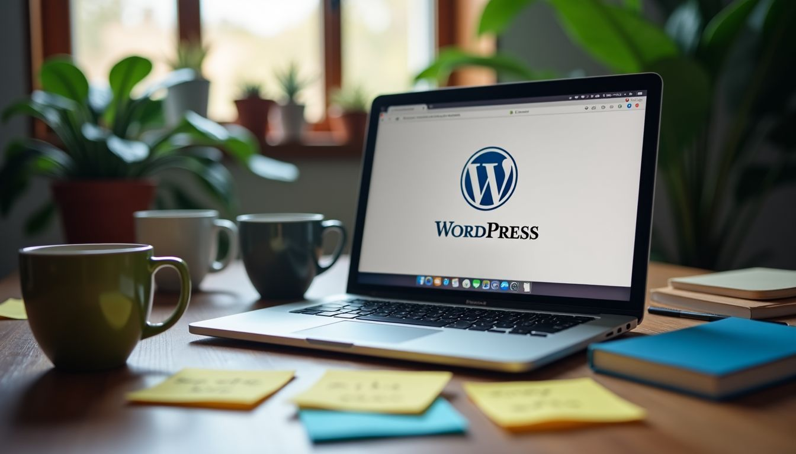

For anyone new to WordPress, the difference between wordpress.com vs wordpress.org has long been a source of chaos and confusion.

It's a topic that comes up so frequently that it's become something of a running joke in the WordPress community. But for small businesses, it's no laughing matter.

An all too common scenario goes like this: Elizabeth, a small business owner of a boutique coffee shop, excitedly creates a website using WordPress.com’s free plan.

However, she quickly faces limitations, including restricted customization options she needs in order to make the most of her website.

Additionally, she realizes she has limited control over her content, which is exactly what she didn't sign up for.

Elizabeth concludes that she should have chosen WordPress.org, which would have offered her the flexibility and control necessary to effectively promote her business online.

The purpose of this post is to assist you in determining which version of WordPress aligns best with your needs, so let's take a closer look and see what we uncover.

### Key Takeaways

- WordPress.com is easy to use and handles all your site's hosting, security, and updates. It has plans that go from free to paid.
- WordPress.org lets you **own your site fully** and customize it with themes and plugins. You **need to find a web host** and handle the technical parts yourself.
- With WordPress.com, you get **support and managed hosting** but **less control over plugins** unless you pick a higher plan. WordPress.org gives more freedom but needs more tech skills.
- Pricing on WordPress.com can fit various budgets with its range of plans. For WordPress.org, you pay for hosting and domains outside of the free software.
- Security on WordPress.com is strong without much effort from the user while those using WordPress.org must manage their security measures.

## Overview of WordPress. com vs WordPress. org

### Key differences between the two platforms

Hosting is a huge difference in the debate between WordPress.com vs WordPress.org. With WordPress.com, everything is taken care of for you. This means your site's speed, security, and updates are all managed by them.

You don't have to do much but build your website. It's like renting an apartment where repairs are not your problem.

WordPress.org lets you be the boss. You get their software for free but finding a place on the internet to put your site is up to you. Think of it as buying a house—you choose where it goes and how it's maintained.

This choice gives you more control, like adding extra rooms or painting walls any color you want through plugins or themes.

Both paths let you create a personal space on the web—whether it’s a blog, online store, or business site—but they offer different levels of freedom and support. So, I always think about what suits my project best before choosing one over the other.

## Comparison of Features

When considering WordPress.com vs WordPress.org, there are important distinctions you should be aware of. Let's explore these variances and their potential impact on your website decisions...

<iframe src="https://www.youtube-nocookie.com/embed/kD_Db3TCno0" title="YouTube video" loading="lazy" allow="accelerometer; encrypted-media; gyroscope; picture-in-picture" allowfullscreen></iframe>

### Pricing

I know pricing matters a lot for small business owners. You want to choose what fits your budget and needs. WordPress.com has **different plans** ranging from **free to enterprise levels**.

The free one is great if you're just starting. But, as your business grows, you might need more features like a custom domain name or extra storage. These come with the paid plans.

For WordPress.org, things work differently. It's free to use the software, but you'll need to pay for **web hosting and a domain name** every year. The **cost can vary** based on which web host you choose.

Some offer deals at first but then the price goes up later on.

Both platforms have their own costs that fit different budgets and needs. Knowing these differences can help decide which platform suits your business best.

Now, let's talk about what experience is needed to use each platform effectively.

### Experience needed

For wordpress.com, you don't need much **tech know-how**. It's great for beginners and pros alike. You pick a plan, set up your site, and they handle the tough stuff like **server uptime and security updates**.

I've walked many clients through this process. They were happy to see how easy it was.

Now, wordpress.org is different. It asks for more tech skills because you do all the **customization and maintenance** yourself. This means dealing with codes and managing your own **web hosting**.

But it gives freedom too. You can change almost anything on your website if you know how. My journey started here, digging into codes and exploring all the possibilities.

Next up is "Hosting".

### Hosting

When you use WordPress.com, the **hosting is included** in their service. It's like a package deal where your website and hosting are combined.

This means that they take care of all the technical parts related to keeping your site online and secure.

You don't have to worry about finding a separate company to host your website when using WordPress.com.

However, with WordPress.org, you need to find a **separate company for hosting**. It's like renting space on the internet so people can view your website.

With this freedom comes more responsibility as you'll need to ensure that your hosting provider offers **good security measures** and has **reliable uptime** for your business' online presence.

For someone who needs simplicity without dealing with additional technicalities, the integrated approach of WordPress.com vs WordPress.org might be suitable - everything taken care of under one roof.

On the other hand, if you want greater control or have specific requirements for performance or security that suit your business better than what standard managed hosting provides, then self-hosted WordPress.org could be beneficial.

### Speed & performance

WordPress.com is a strong choice for businesses looking for a **speed-optimized and high-performance website**.

With **managed hosting**, its built-in features lessen the need for plugins and [ensure consistent management of speed](/blog/wordpress-slow-how-to-fix/) and updates.

This means you can focus on your business without worrying about performance optimization.

In contrast, WordPress.org’s performance highly depends on the chosen hosting provider. As users have to manage **performance aspects** themselves, it requires more **technical knowledge** than WordPress.com, which might be overwhelming for small business owners seeking ease of use.

### Security

[Security is crucial for your website](/blog/why-your-wordpress-emails-are-flagged-as-spam-how-to-fix-it/). With WordPress.com, security is paramount. It automatically updates to fend off vulnerabilities and has **strong backup protocols**. This means less worry for you.

Security with WordPress.org varies based on your hosting and package choice, putting the responsibility in your hands.

You must handle malware issues and stay vigilant about updating security measures on your own.

WordPress.com offers robust security features that keep your site safe from threats without requiring much from you.

### Features

When it comes to features, WordPress.com offers **built-in plugins and themes** designed to simplify website creation.

You can choose from a variety of plans based on your specific needs, including free blog hosting or business packages for online stores and custom websites.

Moreover, WordPress.com provides [managed hosting with security updates](/blog/wordpress-management-strategies-for-marketers/) and site backups for peace of mind.

On the other hand, WordPress.org allows [extensive customization through user-installed plugins](https://nandbox.com/the-impact-of-installing-plugins-on-your-sites-functionality/) and themes, which reveal the strategies to enhancing your website’s functionality.

With self-hosting capabilities, you have complete control over your domain name, content ownership, and site maintenance.

This empowers you to tailor your website's performance metrics as needed, which is especially beneficial if you're looking for more than just a standard business website.

Moving forward in our comparison...

### Plugins

I love using plugins in WordPress! They are like little tools that help add extra functions to my website.

With WordPress.com, you can only install plugins if you’re on the Business, Commerce, or Enterprise plans.

These plans have some pre-installed essential plugins too! But with WordPress.org, there's total freedom - I can **install any plugin** I want and customize my site exactly how I need it to be.

It really gives me **full control** over what I do with my website.

You should know that with WordPress.com’s managed hosting, they take care of **plugin performance risks** for me. On the other hand, when using WordPress.org, managing these risks is entirely up to me.

Whether it’s having more control or less worry about performance issues – this difference makes a huge impact on how I choose which platform is best for my business!

### Themes

When it comes to plugins, let's shift our focus to themes. Themes are key in determining the look of your website when using WordPress.com or WordPress.org.

WordPress.com offers a variety of **customizable themes** for different plan options, enabling some basic customization without requiring much technical knowledge.

Conversely, delving into **self-hosted WordPress** via WordPress.org reveals a vast array of theme possibilities, providing complete freedom to install or develop custom themes tailored to your business requirements.

With this continually developing open-source software, you have the freedom of choice!

### Support

WordPress.com and WordPress.org offer different types of support. On WordPress.com, I've noticed that there are **support forums and webinars available**, but the main advantage is 24/7 customer support for paid plans.

This means you can always get expert help when you need it most. However, with WordPress.org, the support system relies on [community-based forums](https://www.storyprompt.com/blog/community-platforms).

That means you might encounter delays in getting answers to your questions or resolving issues because it's not professionally managed like on WordPress.com.

### Site ownership

When it concerns site ownership, both WordPress.com and WordPress.org offer you **total control over your website's content**.

You **own what you publish**, including text, images, videos, and any other material on your website.

With me at the helm of my very own business website, I comprehend how significant it is for small businesses like ours to have **complete ownership of our online content**.

Whether it's a blog post or an about us page, having that **level of control gives us peace of mind** – something every business owner can appreciate.

## Overview of WordPress. com

WordPress.com is a website builder and hosting service that provides [various plan options for establishing](/blog/whats-the-difference-between-categories-and-tags-in-wordpress/) your online presence. It's crafted to be user-friendly, making it ideal for beginners or those looking for more than just a free blog.

### Sign up and plan selection

To get started with WordPress.com, users **sign up and select a plan** that suits their needs and budget.

There are various options such as Free, Personal, Premium, Business, Commerce, or Enterprise plans to meet different requirements.

These plans determine the features and support level available to users. The sign-up process is straightforward and user-friendly with **transparent pricing information provided by WordPress.com**.

Higher-tiered plans offer more developer tools and extra features tailored towards businesses seeking growth opportunities.

For those interested in using WordPress.org, the process involves downloading the WordPress software.

This option allows for self-hosting and greater technical freedom but requires more hands-on management of hosting as well as security measures, including updates that the site owner must manage themselves.

### Managed hosting and different plan options

Managed hosting makes running a website way easier. It includes **essential things like updates, security, and backups**.

Different plans serve different needs. There are options from personal blogs to e-commerce sites.

If you need fancy tools like **SFTP-SSH or WP-CLI**, the higher tier plans have got you covered.

The best part? You don't need to worry about external hosting services because it's all included in your plan!

So if you're not really sure how to handle web hosting by yourself, **managed hosting** is your friend.

## Overview of WordPress. org

WordPress.org represents the [self-hosted edition of WordPress](https://themeisle.com/blog/self-hosted-wordpress/), granting complete control and flexibility over website customization. It provides access to thousands of free plugins and themes for personalized web design.

### Downloading WordPress software

Acquiring WordPress software from WordPress.org marks the initial phase in establishing a **self-hosted website**.

Commencing with obtaining the **open-source software** at no cost, individuals proceed to choose a **web hosting provider**, managing the installation and setup themselves.

This grants a level of technical independence but necessitates autonomous management of security updates.

Following the download, individuals wield authority over their website, enabling them to personalize it according to their preferences. Moreover, they become part of an extensive community utilizing the same platform.

Commencing with the software is straightforward, facilitating the development of an online presence tailored to meet business requirements.

Up next: "Self-Hosting and Technical Independence"

### Self-hosting and technical freedom

Moving from downloading the WordPress software, let's delve into **self-hosting and technical freedom**.

When you're self-hosting, it means you have the freedom to make **extensive customizations** - no restrictions holding you back.

As for the technical aspects, I'll need to handle research, installation, and maintenance on my own. It also requires some **technical knowledge** because there’s a bit of coding involved.

With self-hosting, I gain control over choosing my hosting provider and security measures that can suit my specific needs.

Self-hosting offers developers with PHP environment changes so they can adjust their website precisely how they want.

This is particularly advantageous when we consider businesses' growth stages and customization needs as it supports a tailored approach towards establishing an online presence that not only reflects but enhances their brand identity while providing full ownership of their content.

The newly found sense of independence isn't overwhelming; instead, it provides first-hand experience in managing resources meticulously—embracing the continuously evolving complexities of enhancing one's online presence—and unlocking new potentials for our business websites.

## Conclusion

In summary, we've uncovered the differences between wordpress.com and wordpress.org. We saw that WordPress.com offers hosting and management but limits customization, while Wordpress.org provides more freedom for tech-savvy users who want to self-host their sites.

The **key variations** lie in control over your site, **technical knowledge needed**, and **pricing options offered**.

It's clear that each platform has its strengths and limitations catering to different user needs. I hope this guide helps you make an informed decision for your business website!
