If you're new to WordPress and you're seeking help for the first time, the options can be overwhelming.

With a little guidance, however, finding the WordPress help you need isn't nearly as difficult as you may think.

Having spent the past 10+ years assisting those in need of WordPress help, I know all the places to go to find the WordPress help you need today.

One of the many things that makes WordPress [the world’s most popular Content Management System](https://kinsta.com/wordpress-market-share/) (CMS), is that it’s an open-source platform.

What this means is that anyone can get their hands on it and customize it to their needs, making it highly customizable.

What it also means is that there’s no official support available for WordPress sites that use the open-source version available on [WordPress.org](https://wordpress.org/).

However: one of the other things that makes WordPress so popular is the vast community of developers and experts willing to bend over backwards to help those in need of WordPress help.

Whether you’re seeking WordPress help via the multitude of blogs and forums available, or hiring professional WordPress help, you’re sure to find the assistance you're in need of.

The being said, I’ve created this comprehensive guide to getting WordPress help so that you’ll feel a bit more confident in what to do next.

## First Thing's First

For the purposes of this post, we're assuming that you're primarily concerned with sorting out your WordPress issues on your own, but with some guidance along the way.

For those who haven't the time or desire to troubleshoot and resolve WordPress problems, you may want to skip ahead to the section on hiring [Professional WordPress Support Services](#professional-wordpress-support-services).

## Identify The Problem

Getting the help you need starts with having a basic understanding of what you need help with. In some cases it can be obvious:

- A social sharing button doesn’t open on-click.
- An image in a slider isn’t automatically advancing to the next slide, even though you’ve applied the proper settings.
- You Contact form freezes up after you click the “Submit” button.

In situations like the above, you know that everything else on your site is working as it should, but for some reason a single, isolated feature isn’t.

Quite often this can be attributed to the Plugin that provides the feature in question. A social sharing Plugin, a slider Plugin, a forms Plugin.

Less commonly those features might be bundled into your Theme, which is less than ideal as it may require that you switch to a new Theme if the problem can’t be resolved.

In either case, you’ll have a good idea what the problem is so you can clearly describe the issue when you reach out for WordPress help.

### Common Problems with WordPress Core

In other cases, it might not be so obvious what’s gone wrong and your problem may be related to an issue with WordPress Core. Common cases like this can be as follows:

#### The “White Screen of Death”

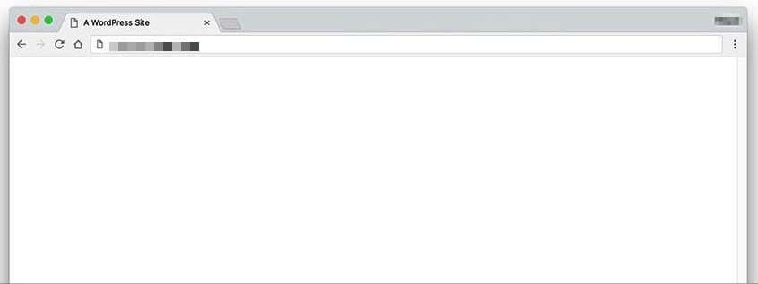

Your screen has gone entirely blank (infamously known as the “White Screen of Death”). I remember how terror stricken I was the first time I saw this. Yikes!

This is typically due to errors in your site’s PHP, either by way of a buggy Theme or Plugin or some combination of both.

#### WordPress Connection Timeout

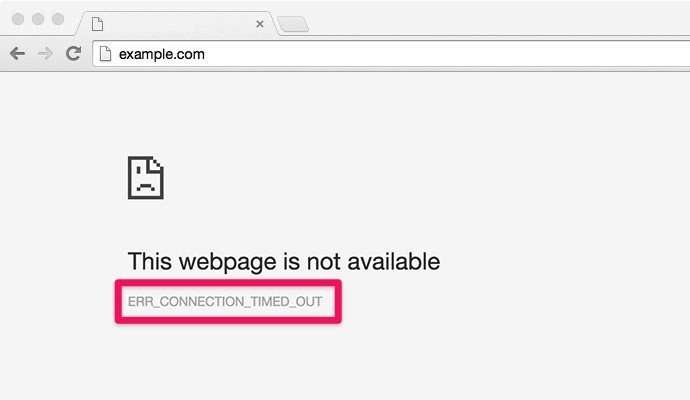

#### Error Establishing a Database Connection

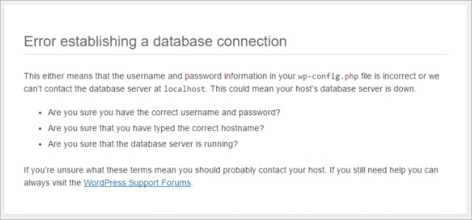

When any of the above, or similar issues occur, you’ll need to take a minute to recall what you were doing prior to the issue arising on your site.

- Did you update WordPress, your active Theme or a Plugin?
- Was anyone else working on your site before you? If so ask them if they updated anything on your site?
- Did your web host warn you of any pending server updates that may have an effect on your website?

Armed with that information, you’ll be a lot better prepared to describe what you need help with when the time comes to reach out for support.

### Take Note of The Problem

If you know what went wrong, and you can duplicate the issue, your next step will be to document it so that you can share it with others when you reach out for WordPress help.

In some cases you may be presented with an error message. If so get a screenshot, as sometimes you might not be able to duplicate the error message for troubleshooting.

When you’re trying to get WordPress help and support, showing others the problems you’re having is so much more effective than trying to explain them in an email.

#### Take a Screenshot of the Issue

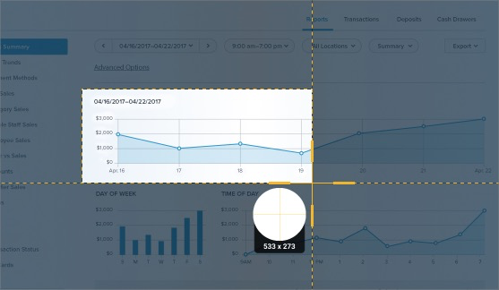

If the issue you’re having is static and can be captured in a single screenshot, using tools like [Snagit](https://www.techsmith.com/screen-capture.html) and [CloudApp](https://www.getcloudapp.com/) can be a huge time saver.

These kinds of tools will allow you to take screenshots that you can then add notes to so that you can better explain what’s going on with your site.

If your issue is dynamic, and can’t be adequately captured using screenshots, recorded video is the way to go.

#### **Create a Screencast of The Problem**

To that end tools like [Loom](https://www.loom.com/) and [Screencastify](https://www.screencastify.com/) are indispensable in showing others exactly what’s going on so you can get to the bottom of the problem.

With screencasting tools you can record and narrate exactly what’s happening, which will make it super clear to viewers what’s going on.

## Troubleshooting WordPress On Your Own

The next thing you’ll want to do is determine how involved you want to be in resolving the issue.

If you’ve got little to no budget to hire an expert for WordPress help, you may have no choice but to seek out WordPress help online and implement suggestions offered by others.

This can be time-consuming as it will likely involve a fair amount of back and forth as you attempt to resolve the issue, but with patience and diligence, you can get it done.

If your WordPress website is used for personal purposes, such as a blog, there’s not a huge amount at stake if things go wrong, so you have ample room to do it yourself.

If, however, your WordPress website is used for business purposes, you’ve got more at stake, both in terms of keeping your site up and running and using your time wisely.

The last thing you want to do is inadvertently take your site down by troubleshooting issues that are beyond your ability to resolve.

It’s also important to consider whether your time as a busy professional is better spent doing what you do best, and leaving the rest to an expert.

If you’re easily frustrated by technology and have little patience for troubleshooting, you may well end up spending hours or even days, trying to solve your problem.

In this case it’s better to be honest with yourself and hire WordPress help, so that you can attend to other matters in your business.

If this is you, you can skip ahead to the part of this post where I’ll point you to several professional support services you can reach out to for WordPress help.

If on the other hand, you enjoy working with new technologies and are up to the challenge, you may want to take a more collaborative approach.

There’s nothing quite like encountering a WordPress problem and resolving it with the help of others who’ve been there before.

## Before You Get Started

In either case, before you seek WordPress help, there are a few things you should keep in mind in order to make the most of your experience.

First and foremost, it’s likely that someone’s already had the same problem you’re having and has already sought help for it.

No matter where you go for WordPress help, that’s what you want to keep an eye out for, be it a forum post, blog post, knowledge base article or otherwise.

In your rush to sort out your problem, the last thing you want to do is reach out to a developer or post a question on a forum that’s already been answered.

Remember: those you’re seeking help from are busy people and so respect their time by not making them answer questions they’ve already addressed.

This is particularly important when your problem is related to a free Theme or Plugin, as the developers are giving their time freely to support your use of their Theme or Plugin.

In other cases, as on the WordPress.org support forums, you may also be interacting with volunteers who give their time to assist those in need.

That being said, if you reach out to someone for WordPress help in a mindful manner, the community will bend over backward to help you.

### Investing in Premium Themes and Plugins

As an aside, I strongly suggest that you invest in premium Themes and Plugins, as they come with support and your odds of getting WordPress help are much greater as a result.

Another reason to invest in premium Themes and Plugins is that you’re supporting the developers by purchasing their products, which is always a good thing.

This isn’t to say that you should steer clear of free Themes and Plugins, as there are a good many that remain in active development and highly reliable.

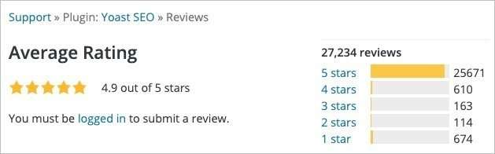

With nearly 26,000 5-star ratings the [Yoast SEO Plugin](https://wordpress.org/plugins/wordpress-seo/) is a great example of a free Plugin found in the WordPress Plugin Repository, that’s a safe bet for your site.

Other Plugins such as [MonsterInsights](https://wordpress.org/plugins/google-analytics-for-wordpress/), [The Events Calendar](https://wordpress.org/plugins/the-events-calendar/), [Ninja Forms](https://wordpress.org/plugins/ninja-forms/), and many others have been around for years and are highly reliable and well-supported too.

## Where To Find WordPress Help

Now that you’ve got a good idea of what you need help with and are clear on how best to ask for WordPress help, you’re ready to start searching for solutions to your problem.

Fortunately, there are a ton of places you can go for help and I’ve created a list of them based upon your particular needs.

### Official WordPress Support Forums

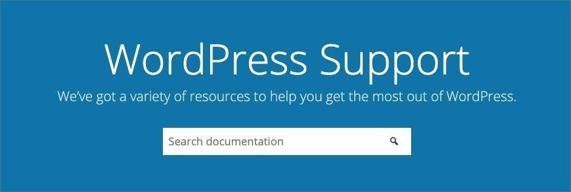

If your issue is related to a problem with WordPress Core, a Theme, or Plugin you installed via wordpress.org, then you’ll want to visit the official [WordPress Support page](https://wordpress.org/support/).

From there you can enter the issue you’re having into the “Search documentation” field and browse the results.

If you know that your issue is related to a specific Theme or Plugin, enter the name of the Theme or Plugin, and it should appear at the top of the results page.

Also, if you already know the issue is related to a specific Theme or Plugin, you can go to the [Themes page](https://wordpress.org/themes/), or [Plugins page](https://wordpress.org/plugins/) and enter the name of the Theme or Plugin.

Let’s say in this instance you’re having an issue with the popular Astra Theme. Visiting the Themes page, you’d enter Astra to view the page for that Theme.

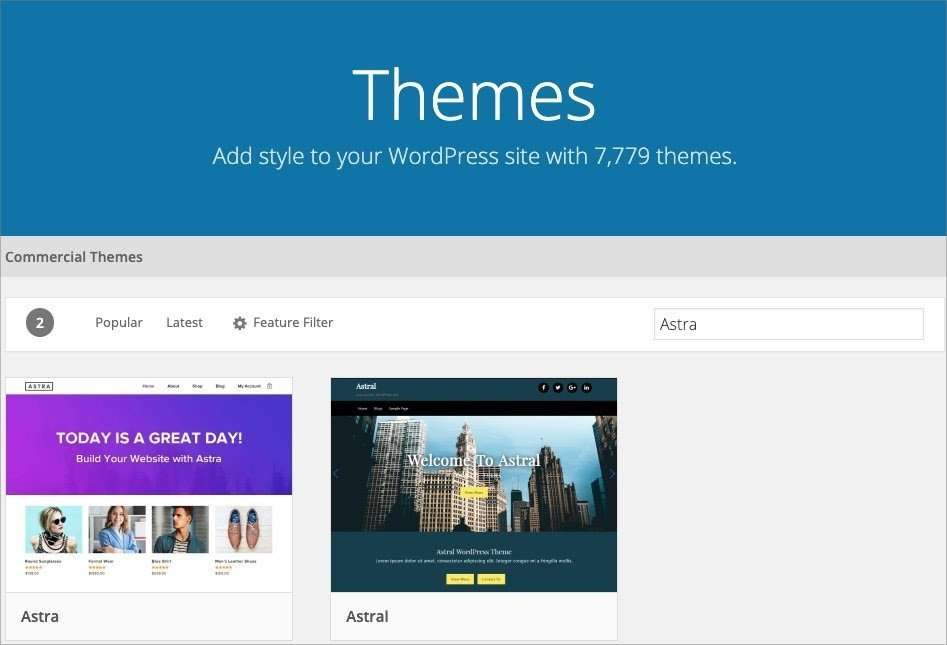

Once you’re on the Theme Page, in this case for Astra, you’d want to click the “View Support Forum” button.

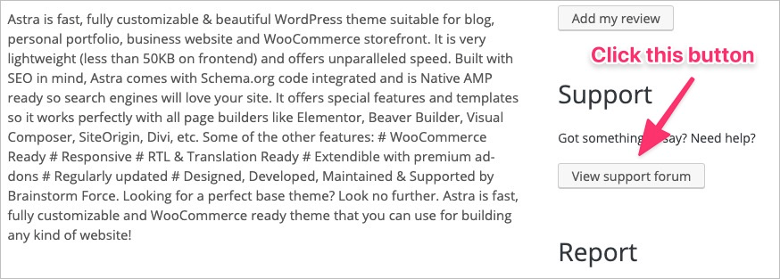

At that point, you’ll see a search field where you can search for the issue you’re having so you can find out if someone else has had a similar problem.

Let’s say you’re having an issue with the vertical height of your Main Menu. Just enter “menu height” into the search bar to pull up all issues related to menu height.

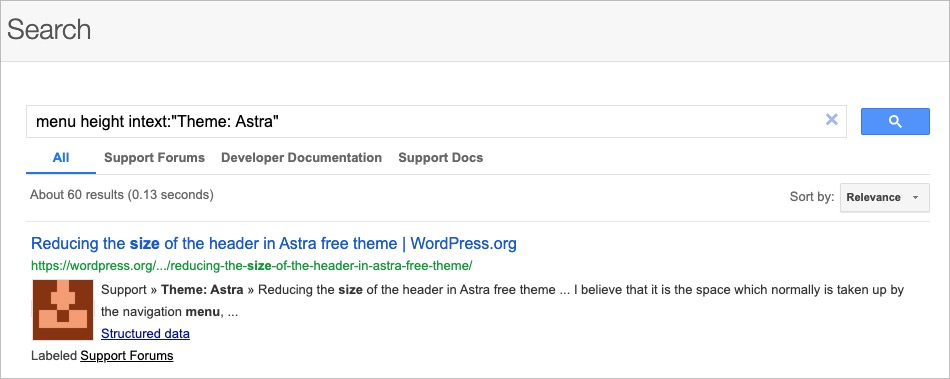

In most cases, you’re likely to learn that the issue you’re having has been noted and a fix is available.

If, however, you find that the issue hasn’t yet been reported, you can always sign up for a WordPress.org account and submit a detailed description of the issue you’re having.

### Sign Up for a Free WordPress.org Account

Signing up for a free WordPress.org account is simple enough. Just head to the [Registration Page](https://login.wordpress.org/register) and create an account.

Once you’ve done so, you’ll receive an email informing you that your issue has been posted, and from there you’ll receive an email each time someone responds.

It’s important to note that if someone takes the time to respond to your post, that you reply to them in a timely manner.

**Remember**: this person has taken time out of their busy schedule to offer WordPress help and failing to respond in a timely manner is disrespectful and damaging to the community.

With each response you receive, take the steps suggested and report back on the results in a timely manner.

If their suggestion proved helpful and solve your problem, be sure to let them know and thank them for taking the time to help you.

If not, kindly let them know that you did what was suggested and unfortunately, in your case, the issue persists.

This will help them consider other possibilities, while you move on to implement any other suggestions that may have been shared with you.

In some cases, you may not be able to resolve your problem in the official WordPress forums and will have to seek WordPress help elsewhere.

### Search It Up

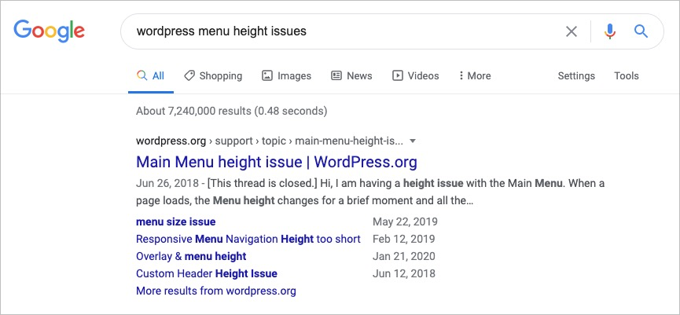

If you can’t find a solution to your problem in any of the official WordPress forums, your next step will be to perform a search for the Theme or Plugin via the search engines.

With all hope the developer has a website that includes either a support forum or a knowledge base that you can use to search for a solution to your problem.

If they do, they should have a support page or knowledge base that you can use to search for a solution to your problem.

In some cases, it may be that the Plugin was removed from the WordPress Plugin Repository and is no longer in active development.

If so, there’s still a chance that you’ll find a solution to your problem, and revisiting your favorite search engine, should yield results.

If no results are returned from the search terms you used, and you’ve got an error code, you might enter that into the search engine to see if anything comes up.

### When All Else Fails

When all else fails, and you’re unable to locate any info on your Theme or Plugin, you may want to consider searching for one that has similar features and replacing it.

A good rule of thumb is to always make sure that the Theme and/or Plugin is compatible with the current version of WordPress.

You’ll also want to make sure that it’s got great ratings and read the reviews so you can ensure that you’re making the right choice.

The last thing you want to do is install a Theme or Plugin that’s going to cause similar problems, or worse, down the road.

As mentioned previously, unless it’s a highly rated Theme or Plugin in active development, you’ll want to go with a premium solution, should any be available.

## Unofficial WordPress Forums

When none of the above have yielded any results, there are plenty of other places you can go to find WordPress help.

Some of these forums may have been returned when you conducted a search, but if not, it never hurts to visit any one of them in your search for a solution.

- [Stack Exchange](https://wordpress.stackexchange.com/)
- [Quora](https://www.quora.com/What-is-WordPress-How-does-it-work-2)
- [Reddit](https://www.reddit.com/r/Wordpress/)
- [Facebook Groups](https://www.facebook.com/groups/advancedwp/)
- [LinkedIn Groups](https://www.linkedin.com/groups/1482937/)

## Professional WordPress Support Services

When none of the above options have proven helpful, you may want to consider throwing in the towel and hiring a professional.

This is particularly important if you use your WordPress website for business purposes, in which case you’ve probably got better things to do than mess with WordPress.

If that’s the case, there are a number of places you can go to find WordPress help and hire someone who can do in a matter of minutes, what would take you hours or days to accomplish.

### PartnerPress

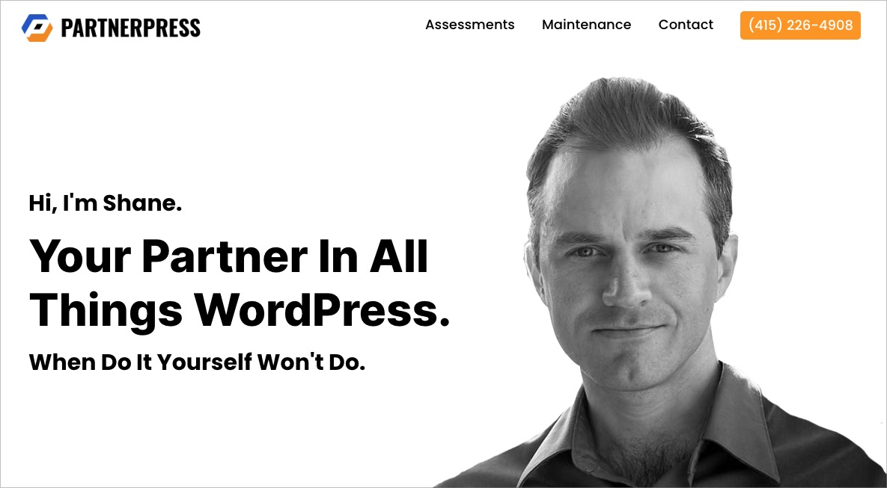

If you’re not in the least bit interested in DIY'ing your way out of your WordPress problems, you may want to consider cutting to the chase and reaching out to me, right here at PartnerPress.

With 12+ years experience solving all manner of problems for businesses in need of WordPress help and support, I can get your problems sorted out in short order.

Whether you need a comprehensive WordPress Audit, or you're looking for support on an [ongoing basis](/services/wordpress-success-plans/), I can provide the WordPress help you need so you can get back to doing what you do best.

To that end, feel free to reach out and [schedule a complimentary consultation](https://meetings.hubspot.com/partnerpress/complimentary-consultation), I’d be happy to discuss your needs and how I can help.

### Upwork

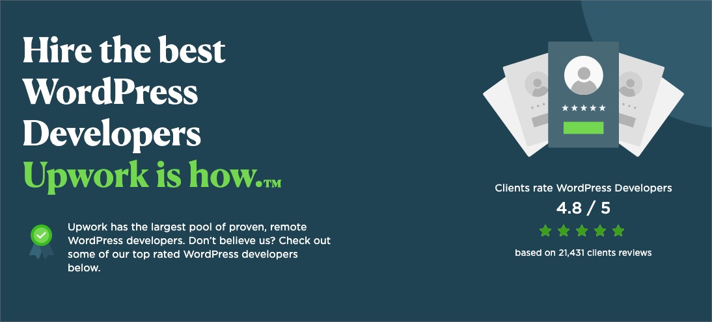

If you haven’t heard of [Upwork](https://www.upwork.com), it’s a freelance marketplace where you can find folks who can help you with just about anything, including WordPress.

Once you’re there you can browse through the profiles of those who can help you with WordPress issues.

You can browse by ratings and location to hone in on the kind of person you’d like to hire for WordPress help.

Although you can create an account and post your job, I caution against this as you’re likely to receive a ton of inquiries from freelancers desperate for work.

You’re better off creating an account and searching for freelancers who meet your requirements.

With each freelancer who does, just save their profile to your account, and once you’ve gathered a handful, reach out and describe the issues you’re having.

In some cases, particularly with highly rated freelancers, you may not get a response right away, so it can be a bit of a waiting game.

### Codeable

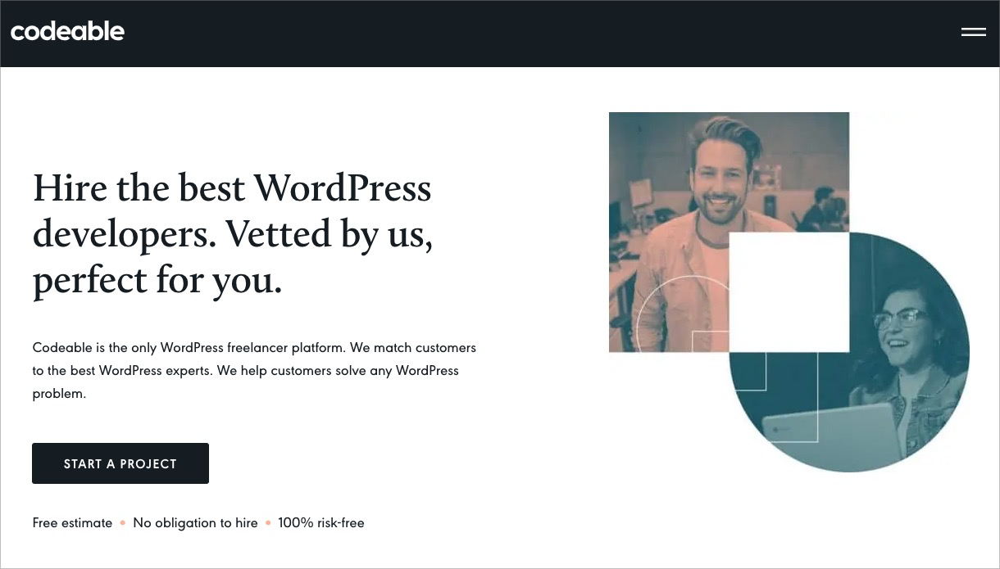

Perhaps better than Upwork is [Codeable.](https://www.codeable.io)[io](https://codeable.io/) which is composed solely of WordPress Developers who can assist with your problem. It's a great place to find WordPress help.

Just go there, create an account and post your job to start receiving bids on your job. Once someone comes up who meets your requirements, you can hire them.

## Wrapping Things Up

As you can see, when it comes to getting WordPress help and support, there’s no shortage of resources available.

The main question is whether you have the time to invest in resolving your WordPress problems.

Remember: unless you’ve opted to hire a professional, embarking upon this journey is going to be a collaborative effort.

It’s going to require time, patience and willingness to take the suggestions of others who are giving their time freely to assist you.

Ultimately, however, you’ll find that once you’ve resolved the issue with the help of others, you’ll feel that much more empowered to address future issues that might arise.

And that’s what makes WordPress such an empowering platform to build your business presence online.
