If your work requires you to be in front of a computer all day, every day, chances are good you spend a ton of time online.

As such, you're likely interacting with dozens of websites, and there are few things worse than finding yourself on a site that's super slow to load.

One thing that *is* worse than that, is when it's *your* website that's super slow to load. Particularly when you're attempting to update content.

With a million things on your to-do list, the last thing you need is to be bogged down by a WordPress installation that takes forever to load.

If load time has been an ongoing issue for you, you're likely wondering why your site is so slow and, more importantly, what you can do about it.

In this post, we'll look at several possible causes for poor performance and discuss what you can do to address them.

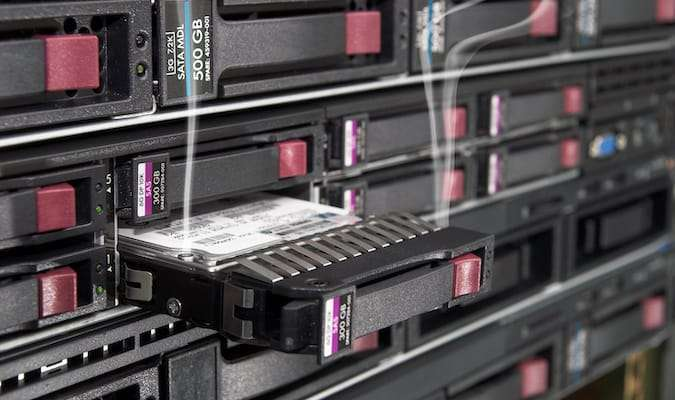

## You Have Poor Web Hosting

One of the biggest factors impacting the load time of a website is your web hosting platform. I see this time and time again in my work with new clients.

More often than not, I'll find that the client is hosting their website on a garden variety host.

By this, I mean it's cheap entry-level hosting that caters to anyone and everyone, which is never a good recipe for a lightning-fast website.

With this kind of host, the server is likely overloaded with hundreds of websites competing for resources, a recipe for slow as-molasses load times.

Ideally, a server has a limit to the amount of information or websites it can host, and when this limit is reached or exceeded, it can pose problems.

In fact, if the server hosts too many websites, those websites compete for resources, making for slow load times if the server isn't powerful enough.

Overloading the server with hundreds of websites means those resources are limited, and the performance of each site is compromised.

Add to this the fact that load time can be severely impacted when the server experiences heavy traffic.

This occurs when a large number of visitors are simultaneously requesting access to the same website.

Under normal circumstances, servers are designed to effectively handle a specific amount of traffic at any given time.

But when the demand exceeds the server's handling capacity, it invariably struggles to keep up.

As a result, the constant bombardment of requests takes a toll on the server's capabilities, significantly slowing down its response times.

In both situations, the consequence remains the same: slow load time, whether it's overloading of websites or heavy traffic.

Slow load time leads to a poor user experience, which results in decreased conversions and lower rankings in search results.

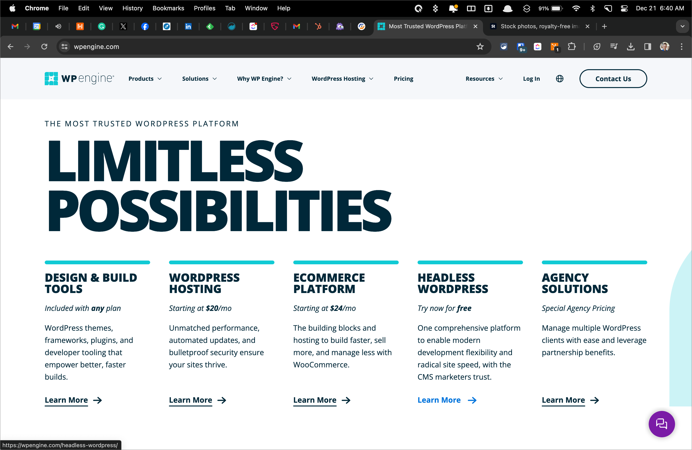

### Migrate to a Quality Web Host

If all of the above sounds familiar, your website is likely being hosted on a garden variety hosting platform and should be migrated to a better host.

That's where Managed WordPress hosting comes in. Managed WordPress hosts have servers that are designed solely for hosting WordPress websites.

As a result, they can optimize load time based on the unique requirements of the WordPress codebase, resulting in faster sites.

Among the Managed WordPress hosts, I recommend WPEngine. Addressing this one factor alone will improve your website's load time.

## You've Got a Ton of Unoptimized Image Files

If you're not optimizing every image on your site before uploading it, there's a good chance your image files are impacting performance.

The problem with images is that the larger they are, the longer it takes for them to load in your browser.

Images that haven't been optimized can consume valuable resources like bandwidth and storage space and take forever to load.

This slow performance can annoy users, making them leave your website and continue their search elsewhere.

Proper optimization strikes a balance between the smallest file size and good quality.

That said, it's crucial that you optimize images before uploading them to ensure that they minimize load time.

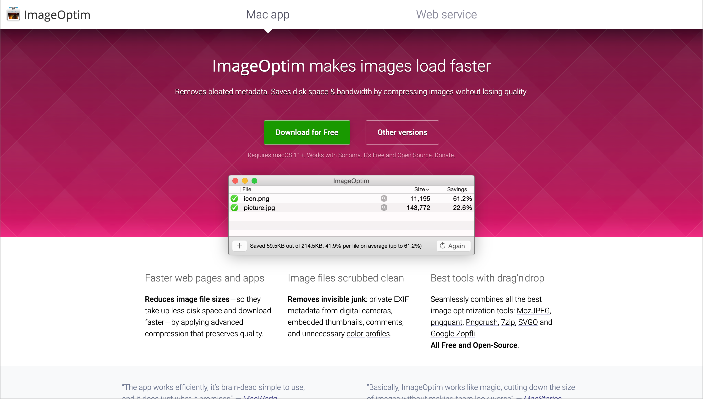

### How to Optimize Images

The first thing you should do is identify the size of images in use on your site and size them before you upload them.

I'll often see clients uploading images well over 2000px wide when the output on the front end is often less than 800px wide.

This forces the browser to scale the image down, which requires additional time and results in, yep, you guessed it, slower load time.

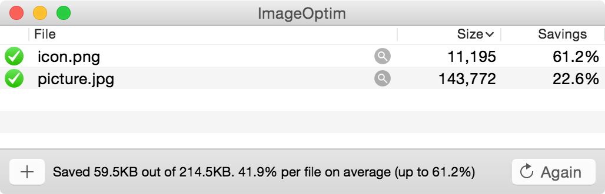

Your next step is to optimize them using tools like ImageOptim, for Mac or [Microsoft Picture Manager](https://support.microsoft.com/en-au/topic/compress-a-picture-4598c336-688b-4ade-a582-ef966a978ffd) for Windows.

These tools reduce the weight of your image files so that when you do upload them to your site, you'll have properly optimized images that reduce load time.

Once you've optimized your image files, you can take it one step further and install the Imagify plugin for WordPress, to perform additional optimizations.

[Imagif](https://imagify.io/)[y](https://imagify.io/) is a hugely helpful plugin for optimizing images already uploaded to your Media Library.

Not only does it reduce the size of image files already uploaded to your site, but it also [serves them in .webp format](https://imagify.io/blog/how-to-convert-images-to-webp/), which further reduces their weight.

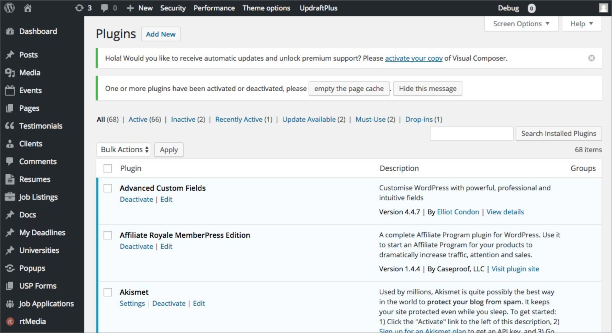

## You Have Way Too Many Plugins Installed

WordPress is a robust and versatile platform that allows you to build sophisticated websites with many features.

One of the key factors contributing to its popularity is the extensive range of plugins available for WordPress websites.

For those new to WordPress, a plugin is essentially a piece of software that can be added to provide additional features to your WordPress website.

When explaining plugins to clients, I often liken them to apps you can install on your phone or computer.

Plugins can do anything from adding a contact form and integrating social media feeds to setting up online stores.

As advantageous and necessary as they may seem, the number of plugins installed on a WordPress site should be kept to a minimum.

The problem lies not with the plugins themselves but with the additional resources required to use them and the added weight to your codebase.

Too many plugins can bog down your website, negatively affecting its performance.

Each time a plugin is installed, it adds code to your website. This results in more code that needs to be processed and increases your site's load time.

So, when someone visits your website, that code must be loaded to deliver the resources requested by your web browser.

This might appear insignificant on the surface, but it amounts to a considerable load time when done repetitively for each web page.

The cumulative effect is that your site slows down. This slowdown might not be noticeable initially, especially when only a few plugins are installed.

But with each additional plugin installed on your website, your website will require much more time to load.

While plugins can extend the capabilities of your WordPress site, it's critical that use them judiciously, keeping the purpose of your website top of mind.

### Keep Your Website Lean and Clean

My recommended fix for the problem of too many plugins is to start with a comprehensive audit of your WordPress installation.

The goal of this audit is to identify which plugins are must-have plugins and which plugins can be removed without having an adverse impact on your site.

The idea here is to keep your WordPress installation lean and clean, which invariably equates to faster load times.

Once you have a list of plugins that can be removed, you'll want to assess their impact before you do so.

This may seem redundant, but it safeguards against breaking things on the front end.

Deleting plugins, however, isn't the final step in the process, as they often leave things behind even when deleted.

Deleted plugins often leave behind files and database tables that are no longer required, creating technical debt that cripples your load time.

This final step will ensure that orphaned files and database tables are removed, keeping your site lean and clean for improved performance.

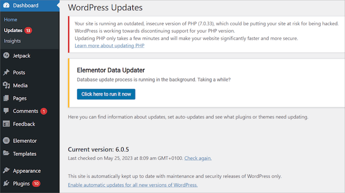

## You're Running an Outdated Version of WordPress

Failing to keep your WordPress installation up to date can lead to various negative repercussions, including slower load times.

Regular updates are integral to maintaining the efficiency and operational performance of any software, including WordPress.

These updates often contain important performance improvements that enhance the overall functionality of the platform.

In addition, these updates aren't just about introducing new features or improved functionality; they're also about rectifying problems identified in previous versions.

They tend to include bug fixes, which are crucial patches intended to eliminate glitches, errors, or security vulnerabilities that have been discovered.

When you opt not to apply these update releases to your WordPress site's codebase, you exclude these bug fixes from your platform.

This makes your website susceptible to the same bugs the updates would have otherwise addressed.

In these kinds of scenarios, you may notice that the load time for your website starts to delay incrementally.

By not keeping up with these updates, you inadvertently degrade the user experience on your site, as your visitors have to endure longer load times.

Over time, this could result in reduced traffic to your website, fewer conversions, and a drop in your rankings in Google search results.

So: regular updates are necessary if you wish to maintain or improve your site’s performance and user experience.

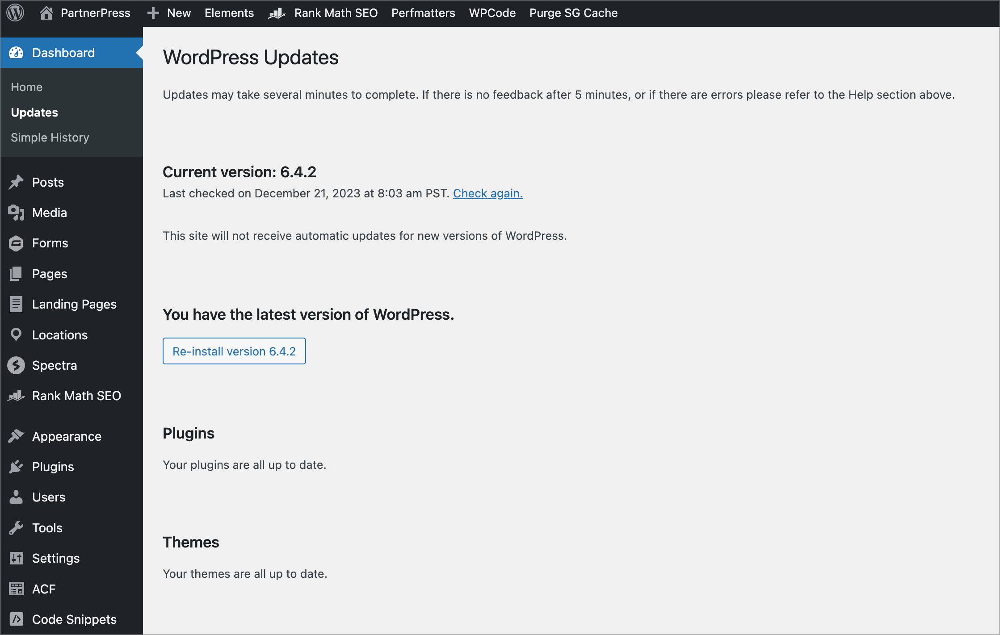

### Regularly Update WordPress

It goes without saying, but for multiple reasons, speed being just one of them, **you must regularly update everything in your WordPress installation.**

This includes WordPress Core, your themes, and all plugins, extensions, add-ons, and patches that may be part of your installation.

However, this isn't something to be done willy-nilly, as it can inadvertently take down your site.

It's critical that you confirm that all updates are compatible with the latest version of WordPress by first checking release notes and changelogs.

To that end, you should test all updates in a staging environment before pushing them back to your production environment or live website.

From there, you should conduct quality testing to ensure that all pages display properly and that all functional elements, such as forms and checkout pages, work as they should.

## You Have a Poorly Coded Theme

Another significant factor that can impact the performance of a WordPress site is the active theme in use on your business' website.

The choice of theme is more than just about aesthetics; it can have real, tangible effects on your site's speed and overall performance.

Making a poor selection may lead to slower load times due to inefficient coding or an overabundance of unnecessary features.

Choosing a theme for your WordPress website should not be taken lightly, as it can influence the operational efficiency of your virtual presence.

A theme with poorly written code can cause a site to load sluggishly, frustrating users and potentially impacting your rankings results (load time is a ranking factor).

In addition, some themes come overloaded with an abundance of bells and whistles that are entirely unnecessary.

While these may look attractive in the demo version, they can contribute significantly to slowing down the site's actual performance once implemented.

Features like sliders, complex layouts, and flashy animations might seem enticing during the theme selection.

Unfortunately, they often demand a substantial amount of server and client-side resources and, more often than not, increase load time.

### Migrate to a Well Built Theme

The theme you choose for your WordPress site directly correlates to its speed, so you should choose wisely.

I can't stress this enough, but **it's crucial that you consider the ultimate purpose of your WordPress website**.

For most businesses, that would be to generate more leads and increase sales to scale and grow.

To that end, every choice about your website should be made with that goal in mind.

Resist the temptation to select a theme with flashy sliders and other animations.

Contrary to popular belief, they don't increase sales but they do slow down your site.

However, finding a well-built theme can be daunting unless you're a WordPress professional.

Fear not, however; with two decades spent working in WordPress day in and day out, I have recommendations.

What you want in a WordPress Theme is the ability to make it look exactly like it appears on your existing website or mockups for a pending redesign.

To that end, I strongly suggest staying away from ThemeForest, which is a marketplace of WordPress themes & plugins.

Unfortunately, most themes you'll find on [ThemeForest are poorly built](https://contentsnare.com/reasons-we-almost-never-use-themeforest-themes/) and bloated beyond belief, making for super slow load times.

Instead, I recommend you choose the leanest, cleanest, most easily customizable theme out there: GeneratePress.

Using [GeneratePress](https://generatepress.com/) on your website, along with the other improvements listed in this post, will vastly improve your site's load time.

## You're Not Making Use of Caching Tools

In the world of website performance, caching is another element that plays an instrumental role in load time.

Caching is a process that stores your website in the visitor's browser, reducing the need to reload your site as visitors navigate through various pages.

Caching conserves resources and abbreviates the path to the requested data when someone visits your website.

This means your browser doesn't have to retrieve all the information from scratch. It can simply "recall" the parts of it that are safely stored in the cache.

This is crucial because, without caching, each visit or click within the same visit would translate into a full retrieval request.

As a result, this demands that the browser request each site element again, significantly increasing load times.

To sum it up, the primary function of caching is to enhance both the speed and efficiency of web pages.

Caching plays an integral role in performance, ensuring visitors have an optimal experience.

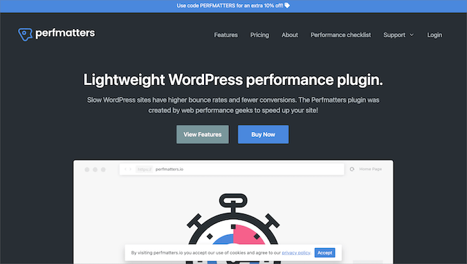

### Enable & Install Caching Tools

The first thing you should do before taking any steps toward improving your site's load time is to generate a baseline report of your site's performance.

Tools like [GTMetrix](https://gtmetrix.com/) and [Pingdom](https://www.pingdom.com/) are super helpful ways to measure your load time at regular intervals.

Start with a baseline report, and from there, run reports each time you update your site.

From there, you'll want to confirm whether or not your current web host offers caching features. If so, you should enable those features.

If not, I suggest migrating to a Managed WordPress host like WPEngine that comes with server-side caching tools and tools to measure performance.

Once you've done that, I recommend installing and configuring a caching plugin to your website.

[The Perfmatters plugin](https://perfmatters.io/) is hands down the best caching plugin out there and is quite popular amongst WordPress developers.

Finally, migrating your DNS, the resource where your domain records are stored, to Cloudflare can provide a much-needed boost to load time as well.

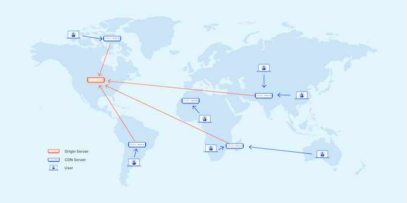

## You're Not Using a Content Delivery Network (CDN)

A Content Delivery Network, or CDN, is a valuable tool that can dramatically improve the speed and performance of a website.

It stores copies, or cached versions, of the site at various points across the global network of servers.

This network of servers spans different geographical locations worldwide, giving the CDN its worldwide reach.

Each server holds a copy of the website's static files, such as images, CSS stylesheets, and JavaScript files.

This broad distribution of servers offers a fundamental advantage: it brings the content closer to users no matter where they might be located.

By decentralizing the distribution of the website, the CDN significantly reduces the distance data has to travel from the server to the end user.

This means instead of having visitors load the site's content from the original server's location, which could be thousands of miles away, they have the ability to access the content from a nearby location.

Imagine if a visitor is based in New York and the server hosting your website is in Sydney, Australia.

Without a CDN, every time this visitor tries to load your website, the request would have to travel halfway around the world, leading to noticeable lag and slower load times.

However, If a CDN is in place, a cached version of your site could be stored on a server in Boston or New York.

The visitor's request would then only need to travel a fraction of the distance, resulting in a considerably faster response time and a smoother overall browsing experience.

In essence, a CDN reduces latency by minimizing the physical distance between the user and the server.

Visitors enjoy quicker load times because their requests are redirected to the server that is nearest to them, instead of one that's further away.

This vital aspect of the CDN allows for quicker response times, faster load speeds, and an enjoyable browsing experience for users all around the globe.

### Get Set Up With a CDN

Check with your web hosting provider to determine if they offer a CDN. If not, [Cloudflare offers a free CDN](https://www.cloudflare.com/application-services/products/cdn/) as part of the DNS hosting.

Setup will require updating your Name Servers and migrating your DNS records to Cloudflare.

Note that **migrating to a new name server is a very delicate process**, so if you have no experience with this, it's not something you want to attempt yourself.

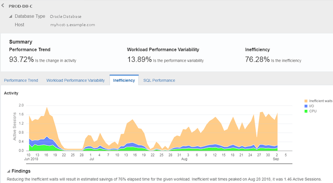

## Inefficient Database Queries

When working with any website, the database is an integral component in its backend operations.

This database, a veritable treasure trove of stored information, is the heart of the website, where all crucial data is located.

Depending on the nature of the website, this data can range from user account details to product inventory, blog posts, and sales on your website.

Accessing this information whenever it's requested by the browser involves making queries to the database.

However, if the queries made to this database aren't optimized, the time required to query and display data is delayed.

Just like how a crowded freeway during rush hour can slow down traffic considerably, unoptimized queries can cause similar problems.

Unoptimized queries are like taking a long and circuitous route instead of a shorter one that takes you directly to your destination.

Almost like a last-minute shopper rummaging through piles of clothes during a sale, these queries will needlessly search through rows upon rows of data.

The ramifications of such inefficient processes can be quite severe. Primarily, the site's overall speed begins to suffer.

Visitors to the website might notice an inexplicable delay in the load times for the various pages.

As with all things that impact performance, slow queries can negatively impact user experience and search results.

Larger sites with higher traffic volumes may experience even further slowdowns during peak usage times.

In addition, it can also affect the website's operational efficiency, especially if the site relies heavily on rapid retrieval and updating of data.

An e-commerce site, for example, may see delayed updates to inventory lists, and social media sites may experience lag in timely updates to user feeds.

This can lead to decreased customer satisfaction and potentially a drop in user engagement or even loss of customers.

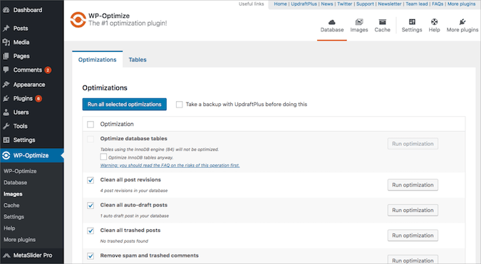

## Optimize Your Database

That said, it's super important for website administrators and developers to ensure that all database queries are well-optimized.

This can be achieved by taking an [inventory of current queries](https://deliciousbrains.com/sql-query-optimization/), identifying those that have the biggest impact on performance, and optimizing them.

An optimized website not only offers a better user experience but also improves the website's overall functionality and productivity.

## Too Many External Scripts Making WordPress Slow

Another crucial factor that can greatly affect this is the utilization of external scripts within your theme and plugins or installed by a developer.

Having too many of them loading on your site greatly impacts your site's load time.

Incremental delays caused by these scripts can add up, significantly reducing the overall speed of your website.

In particular, scripts for ads can greatly influence the load times of your website, especially those with heavy graphics or video content.

These scripts often require substantial bandwidth to load properly, slowing your website.

Similarly, using external fonts, such as Google Fonts and Adobe Fonts, requires scripts to fetch external data, which adds burden to your site.

Other external scripts could include those used for tracking analytics, social media buttons, or even embedded videos from platforms like YouTube.

Each can potentially increase the time it takes for your site to become fully interactive.

While these external scripts often provide necessary features that enhance the functionality or aesthetics of your website, their impact on site load speed can be significant.

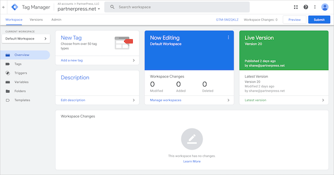

### Get Started with Google Tag Manager

To mitigate the impact of external scripts, **it's critical to assess how they help you achieve your objectives** and act accordingly.

Removing scripts for services no longer in use is a good first step. From there, consolidating your 3rd party scripts to Google Tag Manager is a must.

With [Google Tag Manager](https://marketingplatform.google.com/about/tag-manager/), all your scripts are added to a container that fires via a single script, reducing the impact of external scripts and improving load time.

## You Don't Have Data Compression Enabled

Gzip compression is another essential utility in website performance, dramatically reducing the total size of the files originating from your server.

Gzip compression significantly augments the speed at which these files journey toward their eventual destination: the user's browser.

When data is sent over the internet, it comes at a cost, and typically, the bigger the file size, the longer it will take to reach its end location.

In today's world, where speed is paramount, any delay can lead to negative user experiences or even loss of customers. Hence, smaller is definitely better when it comes to file size.

This is exactly where Gzip compression steps in. It ensures that these resources are compressed and minimized for rapid transport.

Therefore, Gzip compression acts as a performance enhancer for your WordPress website.

It squeezes the files sent from your server, ensuring they are lean and nimble, increasing the speed with which they're transferred to the browser.

This happens behind the scenes, but the effect is visible front and center in the form of faster load times and smoother browsing experiences.

## Enable Gzip On Your Host

As with the previous items, your first step will be contacting your web host. Ask if they offer GZip compression. If they do, ask them to enable it.

If your host doesn't offer Gzip, I recommend migrating to a Managed WordPress host that does.

Again, [WPEngine comes to the rescue](http://wpengine.com/) and wins the day here, and I highly recommend them.

## Conclusion

If you've made it this far, you've learned more about why your WordPress website may be so slow and what you can do about it.

From here, you have to ask yourself if you've got the bandwidth and desire to take the above steps yourself or whether it's best to seek professional help.

If you're considering a career in web development, then by all means, take care of these items yourself.

If not, however, I strongly suggest you contact a professional for assistance with the above items.

The reason I mention this, as I wrap up, is that time is the most valuable commodity you have at your disposal.

If you're not pursuing a career in web development, the last thing you should be doing is spending time learning development.

You should be dedicating your time to achieving maximum impact in your organization.

If "time is money," as they say, **making the best use of your time will save you money in the long run.**
